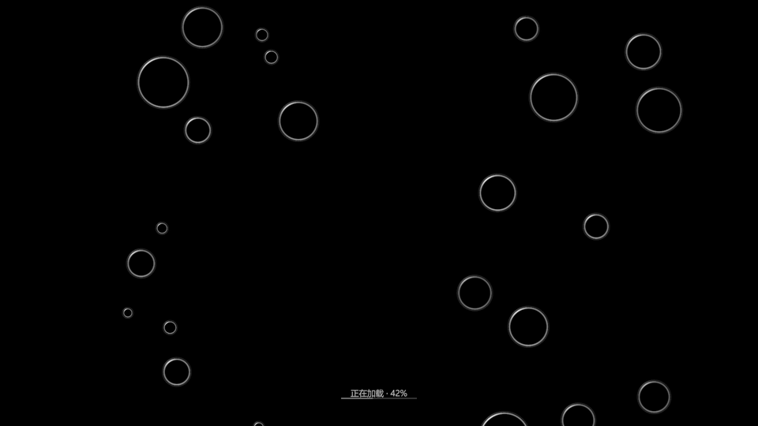

# 黑底加载与泡泡过场验证

2026-10-17，Unity 2022.3.34f1。运行时及编辑器源码编译通过，保留项目已有的 `LevelPathPanel.m_DragStartedByTouch` 未使用警告。

独立工程运行验证 **26 项通过，0 条运行错误**。原始记录见 [report.txt](report.txt)。

- 从实际 Menu 场景启动，验证纯黑相机、置顶黑底、旧对象保留、运行时隐藏旧 Canvas。
- 从 Menu 异步进入 UI Preview，再从暂停返回 Menu，验证输入屏蔽、HUD 就绪、时间恢复及单一过场画布复用。
- 无效场景请求保持菜单可用；减少动态效果下正常完成加载；时间倍率为零时泡泡仍运动。
- 60 秒模拟检查数值稳定、屏幕外循环、形变限制，并验证接触分离和形变响应。
- 1920×1080、960×540、800×900 三种比例实际渲染，并检查泡膜像素可见。

[1920×1080](loading-1920x1080.png) · [960×540](loading-960x540.png) · [800×900](loading-800x900.png)



GIF 是 Unity 网格渲染的 80 帧、20 FPS、4 秒循环预览，固定显示 42% 供画面检查；实际加载进度来自异步加载操作。启动时长和地图切换性能取决于实际设备与场景，本次进入玩法验证使用 UI Preview。

## 重现

```powershell
python Tools/UIV2/prepare_validation.py E:/CodexTemp/PAO-Loading-Review
& 'E:/2022.3.34f1/Editor/Unity.exe' -batchmode -noUpm --burst-disable-compilation -projectPath E:/CodexTemp/PAO-Loading-Review -executeMethod LoadingTransitionReview.RunCLI -logFile E:/CodexTemp/PAO-Loading-Review/loading-review.log -screen-width 1600 -screen-height 900
```

入口要求工程外的验证标记，使用隔离存档与设置；输出在验证工程的 `LoadingReview`。不要在主工程运行该入口。
