# 《泡涌》完整策划案

> **版本 v2.31** ｜ 2026-10-13 ｜ 本文档为**主文档**
>
> 归档：[archive/04-完整策划案_v2.31_2026-10-13.md](archive/04-完整策划案_v2.31_2026-10-13.md)
>
> **v2.31**：新增**4 种特殊泡泡**（连锁/镜像/吞噬/共鸣）作为**后续开发方向**
>
> **v2.30**：确定**具体数值**（容积/恢复值/复原时间）；确立**关卡倒计时→泡泡潮**；恢复倍率 1.5
>
> **v2.29**：扩展**六种场景泡泡**（含硬化/复合）；确立**消耗只看体积（2-12）**；明确三种能力同消耗不同增益
>
> **v2.28**：澄清**关卡规模**——5 关为第一版展示范围，后续可扩展更多
>
> **v2.29**：**资源系统重构**——移除回收机制；泡泡值改为**破坏可破坏泡泡恢复**（破坏=赚，爆炸=花）。术语“泡泡液”统一改为“泡泡值”，删除“回收”“不可回收消耗”。§6 整章重写。
>
> **v2.26**：主角形象重设——半透明蓝色果冻水母 + 大号头戴式耳机（取代储泡泡液罐），6 条触手，星星贴纸与腮红保留；正/背面图见 §10.3。
>
> **v2.25**：整合前三关教学规范；恢复普通泡泡回收；明确爆炸泡泡不可回收消耗缓慢回复；补充术语、逐关验收与 TBD 清单。
>
> **本次修订边界**：主角视觉与配饰以本版为准；储罐移除后泡泡值的承载方式需同步确认（见 §15 D10）。前三关规则、第四/五关方向不变。下面的旧版本摘要仅用于回溯。
>
> ⚠️ **v2.00 为方向性重构**：3D 化 + 能力系统重建（三种泡泡）+ 蓄力释放输入
>
> **v2.01**：浮粘泡泡新增「黏合代价」——接触其他泡泡后永久失去漂浮能力
>
> **v2.02**：补入三种泡泡空间设计稿
>
> **v2.03**：浮粘泡泡两种漂浮方式（蓄力 5 秒 / 泡泡空间无限）+ Z 轴闸门
>
> **v2.04**：浮力泡泡更名**浮粘泡泡**；新增**泡泡值系统**（弹力/浮粘可回收，炸弹不可回收）
>
> **v2.05**：补入两种漂浮方式的流程图
>
> **v2.06**：炸弹泡泡新增**爆炸推力**（改变运动方向）；新增 4.4 组合玩法举例
>
> **v2.07**：美术风格定为**斯普拉遁风格**；主角改为**蓝色水母**；补入吐泡泡表情差分表
>
> **v2.08**：补入 8 张角色三视图（含两种漂浮状态）+ Spine 部件拆分图
>
> **v2.09**：美术风格强化为 **Splatoon 3 级**；背包改为**金属储泡泡液罐**；重做全部角色图
>
> **v2.10**：储罐改**可爱糖果风**；涂鸦感加强；新增**表情红线**（搞笑但不丑化）；重做全部角色图
>
> **v2.11**：关卡设计重写（1-3 教学 / 4-5 正式）；新增**粉色泡泡**设定；确立**弹力泡泡=前置泡泡**；炸弹恢复机制
>
> **v2.12**：核心规则重写——新增**场景可破坏**（参考咚奇刚）；确立**恢复=愈合**（分裂→膨胀→融合）
>
> **v2.13**：新增**涌现玩法**（炸弹+弹力=人为永久破坏）；愈合参数列为程序暂定
>
> **v2.14**：**画风转向手绘厚涂**；确立配色体系；地图定为**箱庭**
>
> **v2.15**：配色改为**粉紫基调**（参考火山旅梦）；场景改为**海洋水下**（第2关起）；主角确立**水母+人形立绘**双形态
>
> **v2.16**：角色图换为**粉紫水下背景**（角色本体保留）；场景背景统一厚涂风
>
> **v2.17**：色板新增**泡泡墙功能材质**维度；补充世界层泡泡初版灰盒图

---

## ⚠️ 版本范围说明

**游戏名**：暂定《泡涌》

### 关卡规模：5 关是「展示范围」，不是「最终规模」

> ⚠️ **重要澄清**：本项目**不是只做 5 关**。
>
> **5 关是第一版（11 号）展示的内容范围**——
> 用于展示核心机制与美术风格。
>
> **后续交付时，在这个基础上能做多少关做多少关。**

| 阶段 | 关卡 | 说明 |
|------|------|------|
| **第一版展示（11 号）** | **5 关** | 展示范围——证明机制成立 |
| **后续交付** | **尽可能多** | 在 5 关基础上继续扩展 |

**这意味着**：

| 设计原则 | 说明 |
|---------|------|
| **关卡可扩展** | 系统设计要支持**任意数量**关卡，不能写死 5 关 |
| **内容可复用** | 关卡元素（墙体材质、谜题模式）应可**组合复用** |
| **数据驱动** | 关卡配置应数据驱动，加关卡不改代码 |

> **v1 展示范围**：5 关（1-3 教学 / 4-5 正式），教会玩家全部核心机制。
| 叙事 | 埋伏笔，不讲完整故事 | 序破急 + 莫比乌斯结局 |
| 能力 | 3 种基础泡泡，并在教学中学习连接体与物理组合 | 更复杂的组合与复合关卡 |

---

## 目录

| 章 | 内容 |
|----|------|
| 一 | 项目概述 |
| 二 | 世界观与设定 |
| 三 | 核心规则系统（含场景可破坏） |
| 四 | 泡泡能力系统（玩家层） |
| 五 | 输入与释放 |
| 六 | **泡泡值资源系统**（破坏补充 / 爆炸消耗 / 旧扩展方案） |
| 七 | 核心循环 |
| 八 | 关卡设计（1-3 教学 / 4-5 正式） |
| 九 | 剧情设计 |
| 十 | 美术设计（含参考图） |
| 十一 | 音频设计 |
| 十二 | UI / UX |
| 十三 | 技术架构 |
| 十四 | 开发计划 |
| 十五 | 待确认项 |

---

## 0.1 术语规范

| 术语 | 定义 |
|------|------|
| **泡泡体** | 可交互泡泡的统称。 |
| **粉色泡泡（墙）** | 主要可破坏障碍物，过一定时间后恢复。 |
| **诞生泡泡体** | 主角诞生点，也是最初的存档点。 |
| **泡泡值** | 玩家资源；靠破坏可破坏的泡泡恢复。 |
| **破坏补充** | 破坏粉色泡泡等可破坏物时，泡泡值回升。这是泡泡值的唯一常规来源。 |
| **爆炸消耗** | 爆炸泡泡消耗泡泡值但不产生补给，须靠破坏其他可破坏泡泡补回。 |
| **前置泡泡** | 用于构建、生成或转化出其他泡泡的基础材料形态。 |
| **泡泡连接体** | 多个泡泡通过黏合等方式拼成的结构，可作为玩家自制通关工具。 |
| **浮力泡泡** | 达到一定大小后可包裹玩家并飞行。 |
| **爆炸泡泡** | 质量大、可由玩家控制爆炸、提供向外力；爆炸力与泡泡大小相关。 |

**旧称对照**：正文统一使用“泡泡值”“浮力泡泡”“爆炸泡泡”“黏合”。旧稿中的“泡泡液”已统一改称“泡泡值”；“浮粘泡泡”是浮力/黏合能力的旧合称，“炸弹泡泡”是爆炸泡泡的旧称；图片文件名不因术语修订而改变。黏合与浮力是否共用一个实体、状态如何转化，仍需细化，不额外增设能力种类。

**资源口径**：泡泡值只有一个来源——破坏可破坏的泡泡；没有回收机制。泡泡值上限与破坏回复效率为 TBD（T04）。旧储液罐已在 v2.26 移除，泡泡值的承载方式见 §15 D10。

## 0.2 通用规则

| 维度 | 本版规则 |
|------|----------|
| 教学节奏 | **限制行动 → 玩家操作 → 系统反馈 → 机制命名 → 解锁自由**；机制命名可用简短提示，不先用长篇说明替代操作。 |
| 资源 | 泡泡值有限；靠破坏可破坏的泡泡恢复；爆炸消耗泡泡值但不产生补给。 |
| 失败与存档 | 掉入空洞返回**房间初始点**；诞生泡泡体作为最初存档点。返回点的精确位置与重置范围为 TBD。 |
| 视觉 | 前三关教学空间以**白色为主**，仅少量可交互泡泡类型；可窥见记忆泡泡世界景观。旧粉紫水下方向可用于远景和后续空间，不压过当前教学焦点。 |
| 物理 | 泡泡可以组合，组合结果主要用于物理表现、移动、搭建与解谜。 |
| 参数状态 | 下文明确列为 TBD 的参数未定案；旧数值只能作为测试候选，不得直接写成最终验收阈值。 |

---

# 一、项目概述

## 1.1 一句话

**在意识之海里吹出泡泡——三种泡泡互相影响、彼此组合，搭出你从未设计过的路。**

## 1.2 定位

| 项 | 内容 |
|----|------|
| 类型 | 关卡解谜 |
| 表现 | **3D 箱庭**（斜俯视，固定机位） |
| 画风 | **手绘厚涂** |
| 配色 | 前三关教学空间**白色为主**，环境参考为明亮蓝天与白色云海；粉紫保留为记忆远景及后续空间方向（详见 §10.2） |
| 场景 | 前三关以少量可交互泡泡组织白色/云海教学房间，可窥见记忆世界；海洋水下景观沿用为远景及后续空间参考 |
| 主角 | **蓝色果冻水母**（半透明、6 条触手、头戴式耳机；游戏内）+ **人形立绘**（剧情/宣传，是否保留待确认） |
| 平台 | **PC 优先**（键鼠 + 手柄）；移动端仅预留适配方向 |
| 规模 | **第一版展示 5 关**（1-3 教学 / 4-5 正式）；**后续可扩展更多** |
| 主题 | 涌现（Emergence） |

## 1.3 核心体验

玩家作为**意识体**，用**泡泡**在记忆空间中搭建通路、破解机关。

三种泡泡（弹力 / 浮力与黏合 / 爆炸）**互相影响、彼此组合**——
单独看每一种都很简单，组合起来却能做出玩家自己都没想到的事。

玩家逐渐发现：自己在**重拾一个已经破碎的自我**，
最终**抛却原有的"标签"，得到自我的成长**。

最后明白：**这个故事的结局，正是它的开头。**

## 1.4 主题如何落地

**涌现 = 简单规则 + 个体交互 → 宏观复杂行为。**

**三层结构，两层咬合：**

```
世界层    泡泡之间的物理交互           ← 分裂 / 融合 / 膨胀（玩家不能直接控制）
   ↑
玩家层    主角用三种泡泡能力干预        ← 弹力 / 浮力与黏合 / 爆炸
```

**关键**：玩家的能力**不是外挂的作弊器，而是世界规则的杠杆**。

**三种泡泡互相影响组合** → 这就是本作的涌现来源。

> **少即是多**：3 种泡泡 × 1 个蓄力输入 × N 种材质 = 玩家无法一次性推演的局面。

---

# 二、世界观与设定

## 2.1 空间结构

```
┌─────────────────────────────────────────┐
│           大泡泡（世界本身）              │
│                                         │
│   ┌──────┐   ┌──────┐   ┌──────┐        │
│   │ 房间 │   │ 房间 │   │ 房间 │  ...   │  ← 意识空间（分裂出的泡泡）
│   └──────┘   └──────┘   └──────┘        │
│                                         │
│   ▓▓▓▓▓▓▓▓ 黑色深渊（死亡）▓▓▓▓▓▓▓▓     │
└─────────────────────────────────────────┘
```

| 概念 | 设定 |
|------|------|
| **大泡泡** | 整个世界。一切都在它内部 |
| **意识空间** | 大泡泡内部分裂出的各个房间——**以箱庭形式呈现**（见 10.2.2） |
| **场景演进** | 前三关白色教学空间，可窥见记忆泡泡景观；旧海洋水下方向保留为远景与后续空间参考 |
| **记忆碎片** | 以泡泡形态存在的记忆 |
| **空洞 / 黑色深渊** | 遗忘与消失的空间表现；掉入后返回**房间初始点**，不是永久死亡 |
| **资源不足** | 暂时不能释放所需泡泡；去破坏可破坏的泡泡补充泡泡值，不强制重开（见 6.6） |
| **主角** | **意识体**——操控泡泡行动 |

## 2.2 美术统一原则

**一切皆泡泡，但主角是 3D 小人的形象。**

- 陷阱是泡泡
- 地图主题是泡泡
- **UI 也是泡泡**

玩家目之所及**没有"非泡泡"的元素**。

## 2.3 泡泡材质

**材质是关卡差异化的主要手段。**

### 玩家泡泡的材质

| 材质 | 特性 | 玩法含义 |
|------|------|---------|
| **易碎** | 一碰就裂 | 高风险通道 |
| **黏性** | 与其他泡泡强吸附 | 搭桥、粘连 |
| **透明** | 可穿透 | 穿过障碍、看见内部 |
| **坚硬** | 分裂不开 | 需要先软化才能处理 |
| **弹性** | 可被弹力大幅拉伸 | 弹跳、远距离移动 |

### 场景墙体的材质

> ⚠️ **不同功能的墙用不同配色**——配色表见 [10.2 色彩](#102-色彩)。

| 材质 | 配色 | 玩法 |
|------|------|------|
| **普通墙** | 云粉 `#F5C6D8` | 可破坏，会愈合（最常见） |
| **不可破坏墙** | 雾紫 `#B48BC4` | 无法破坏，关卡边界 |
| **弹性墙** | 水青 `#7ED4D4` | 可弹跳、可穿过 |
| **爆炸墙** | 暖橙 `#FFB87C` | 触碰会爆炸 |
| **脆弱墙** | 珊瑚 `#FF9E9E` | 一碰就碎，不愈合 |
| **虚空/深渊** | 夜紫 `#4A3F6B` | 掉入后返回房间初始点 |

**视觉规则**：

```
浅色（云粉）  →  可破坏，"轻"
深色（雾紫）  →  不可破坏，"重"
暖色（橙/珊瑚）→  危险，需谨慎
```

> **玩家不需要教程——看颜色就知道这面墙能不能碰。**

# 三、核心规则系统（世界层）

> **这一层是泡泡自己的物理法则，玩家不能直接控制——只能通过泡泡能力去拨动。**
>
> ⚠️ **本章是 v2.12 重点重写章节**——三条规则从"抽象法则"升级为**玩家能看见的物理过程**。

## 3.0 场景可破坏：世界是一整块泡泡

> **旧扩展方案，适用范围待确认**：本章保留场景广泛可破坏、愈合以及爆炸造成永久空洞的既有设计。前三关当前确认的是粉色泡泡可破坏、一定时间后恢复；“所有地面/天花板可破坏”和“爆炸永久破坏”尚未纳入本次验收。**环境是否愈合**与**泡泡值能否补充**是两套不同规则，不可互相推导。

**参考《咚奇刚：蕉力全开》的破坏玩法。**

```
┌─────────────────────────┐
│  █████████████████████  │  ← 天花板（可破坏）
│                         │
│  ███   玩家   ███       │  ← 墙壁（可破坏）
│                         │
│  █████████████████████  │  ← 地面（可破坏）
└─────────────────────────┘
```

**场景（墙壁、天花板、地面）本身就是泡泡构成的**——它们不是静态碰撞体，而是**可以被破坏、也会自己愈合的活体物质**。

| 破坏方式 | 结果 |
|---------|------|
| **弹力泡泡** | **暂时破坏**——过一段时间会恢复 |
| **炸弹泡泡** | **永久破坏**——不再恢复 |

> **设计价值**：
> 玩家不是在"解一道固定的谜题"，而是在**改造一个活的场景**。
> 每一关的场景都是**可塑的**，但塑形有代价。

---

## 3.1 规则 ①：分裂

泡泡受到扰动时分裂。

> **玩家的一切操作都是扰动**——所以不需要"分裂键"。

**在场景破坏中的体现**：

```
    ████          ██  ██
    ████   ──→    ██  ██
    ████          ██  ██
   完整墙体        分裂成小块
```

墙体被击中后**分裂成若干小块**——这是恢复的第一步。

---

## 3.2 规则 ②：融合

同类泡泡靠近自动融合。

**在场景恢复中的体现**：

```
    ██  ██
    ██  ██   ──→   ██████
    ██  ██         ██████
   分散的小块       重新融合
```

**这是"愈合"的关键一步**——分散的泡泡重新聚合成完整墙体。

---

## 3.3 规则 ③：膨胀

泡泡膨胀时，向四周弥散影响，**改变全场的相吸相斥强度**。

> **这是反馈回路，也是涌现的引擎。**
> **非线性从这里来。玩家无法穷举，就是因为这条回路。**

**在场景恢复中的体现**：

```
    ██  ██
    ██  ██   ──→   ██████   ← 膨胀，填满空隙
    ██  ██         ██████
   有缺口          完全填满
```

**膨胀负责"填缝"**——让分裂开的泡泡能够重新贴合，不留空隙。

---

## 3.4 恢复机制：不是重置，是愈合

> ⚠️ **这是本章最重要的设计点。**

### 恢复的三个步骤

```
破坏后的墙体
     ↓  ① 分裂
  小块散开
     ↓  ② 膨胀
  向外弥散，填补空隙
     ↓  ③ 融合
  重新结合成完整墙体
     ↓
   恢复完成
```

**关键**：恢复**不是**"时间到了，墙自己变回来"，
**而是旁边的泡泡自己执行了「分裂 → 膨胀 → 融合」三个动作，把缺口补上**。

> **这就是"愈合"，不是"重置"。**
>
> 它让三条规则从**设定文字**，变成了**玩家看得见的物理过程**。

### 两种破坏，两种后果

| 破坏源 | 机制 | 恢复 | 设计意图 |
|--------|------|------|---------|
| **弹力泡泡** | 物理冲击 | ✅ **会恢复**（周围泡泡愈合） | 低风险，鼓励实验 |
| **炸弹泡泡** | 彻底消灭 | ❌ **永久破坏** | 高风险，改变关卡 |

```
弹力破坏  →  墙碎了 → 旁边泡泡愈合 → 墙回来    （可逆）
炸弹破坏  →  墙没了 → 没有泡泡能愈合 → 永久空洞  （不可逆）
```

> **为什么炸弹是永久的？**
>
> 因为炸弹**彻底消灭了那部分泡泡**——周围没有足够的泡泡来"愈合"它。
>
> 这不是规则强加的限制，而是**规则自然推导出的结果**。

### 这个设计带来了什么

| 效果 | 说明 |
|------|------|
| **降低挫败** | 弹力破坏可恢复 → 玩家敢试错 |
| **制造决策** | 炸弹破坏不可逆 → 用之前要想清楚 |
| **主题契合** | "愈合"呼应"记忆可以重新拼合" |
| **规则可见** | 玩家**亲眼看到**三条规则在工作 |

---

### 💡 涌现玩法：人为制造不可逆的洞

**愈合依赖"周围有泡泡"**——这个前提本身就是一个可被玩家利用的机制。

```
① 先用炸弹清空周围的泡泡
        ↓
② 再用弹力泡泡破坏中间的墙
        ↓
③ 周围没有泡泡可以愈合它
        ↓
   弹力破坏，却产生了永久空洞
```

**这是纯粹的涌现结果**——规则里没有写"弹力破坏也能永久"，但**两条规则交叉作用，自然产生了这个结果**。

| 效果 | 说明 |
|------|------|
| **玩家自主性** | 玩家自己发现了"规则之外"的解法 |
| **组合深度** | 炸弹 + 弹力 = 一个设计者没写死的效果 |
| **符合主题** | 简单规则交叉 → 产生超出预期的结果 |

> ⚠️ **关卡设计提示**：
> 这意味着**任何用弹力破坏就能通过的地方，玩家都可能用炸弹"焊死"**。
> 设计关卡时要考虑：**这会不会让关卡变得不可解？**
>
> 建议：关键通路的关键部分，用**炸弹也炸不掉**的材质保护。

### ⚠️ 愈合参数（待程序调优）

| 参数 | 状态 |
|------|------|
| **愈合开始时间** | 🟡 程序暂定 |
| **愈合速度** | 🟡 程序暂定 |
| **是否受泡泡大小影响** | 🟡 程序暂定 |

> 这三个参数**直接影响关卡节奏**，需要在 P0 阶段用灰盒反复测试。
> 详见 [十三、技术架构] 与 [十四、开发计划]。

---

## 3.5 三条规则的关系

```
        分裂 ①
       ↗      ↘
    扰动         融合 ②
       ↖      ↙
        膨胀 ③
          ↑
      恢复循环
```

**三条规则不只作用于玩家的泡泡，也作用于整个场景。**

| 场景 | 规则如何体现 |
|------|-------------|
| **破坏** | ① 分裂——墙体裂成小块 |
| **恢复** | ①分裂 → ③膨胀 → ②融合——完整的愈合链 |
| **不可逆** | 炸弹消灭了泡泡，① ② ③ 都无法执行 |

> 💡 **玩家不需要读规则说明**——他们破坏一面墙，看着它自己长回来，
> 就**理解了全部三条规则**。

---


---

# 四、泡泡能力系统（玩家层）

> **三种泡泡，是玩家拨动世界规则的三种杠杆。**
>
> **本版确定规则**：弹力泡泡既能破坏粉色泡泡，也是其前置材料；泡泡可以黏合形成连接体；浮力泡泡达到大小阈值后包裹玩家飞行；爆炸泡泡质量大、可控爆炸且提供大小相关的向外力。
>
> **旧能力方案保留区**：本章原有“浮粘”“炸弹”图稿及两种漂浮方式、2 倍/5 秒阈值、黏合后固定失去浮力、单枚炸弹限制、释放方式与组合例子保留供评审。涉及浮力阈值、飞行控制、引爆方式的内容**均是旧候选，不是本版定案**；最新教学与待定状态以 §8 和 §15 为准。

## 4.0 场景泡泡

> ⚠️ **v2.29 新增 6 种，v2.31 记录 4 种后续方向**。
>
> **这些都是场景对象**（玩家要破坏的），**不是玩家能发射的泡泡**。
> 玩家发射的仍是三种：弹力 / 浮力 / 爆炸。

| 范围 | 数量 | 状态 |
|------|------|------|
| **当前开发** | **6 种** | ✅ 普通/弹性/脆弱/补给/硬化/复合 |
| **后续扩展** | **4 种** | 🟡 连锁/镜像/吞噬/共鸣（见 4.0.10） |

### 4.0.0 总览

| # | 泡泡 | 颜色 | 容积 | 恢复 | 破坏方式 | 定位 |
|---|------|------|------|------|---------|------|
| 1 | **普通泡泡** | 云粉 `#F5C6D8` | 低 | 快 | 弹力 / 爆炸 | 基础障碍 |
| 2 | **硬化泡泡** | **岩灰** `#8B8FA3` | 高 | 中 | ⚠️ **仅爆炸** | 强制用炸弹 |
| 3 | **复合泡泡** | **琥珀** `#E8A33D` | 高 | 中 | ⚠️ **需叠加** | 强制组合 |
| 4 | **补给泡泡** | 水青 `#7ED4D4` | 极低 | 慢 | 弹力 / 爆炸 | 资源补充 |
| 5 | **弹性泡泡** | **青绿** `#6BC9A8` | 中 | 快 | 弹力 / 爆炸 | 弹跳通道 |
| 6 | **脆弱泡泡** | **珊瑚** `#FF9E9E` | 极低 | ❌ 不恢复 | 弹力 / 爆炸 | 一次性通路 |

> **颜色设计原则**：
> - **冷色系**（粉/青/青绿）= 安全、常规
> - **暖色系**（琥珀/珊瑚）= 特殊、需注意
> - **灰色**（岩灰）= 坚硬、打不动

---

### 4.0.1 普通泡泡（云粉 `#F5C6D8`）

| 项 | 值 |
|----|-----|
| 颜色 | **云粉** `#F5C6D8` |
| 容积 | **低**（1-2 击） |
| 恢复 | **快** |
| 破坏 | 弹力 ✅ / 爆炸 ✅ |

**定位**：**基础障碍**——最常见的可破坏泡泡，教学与日常使用。

---

### 4.0.2 硬化泡泡（岩灰 `#8B8FA3`）⭐

| 项 | 值 |
|----|-----|
| 颜色 | **岩灰** `#8B8FA3`（灰调 = 坚硬） |
| 容积 | **高**（3-5 击） |
| 恢复 | **中** |
| 破坏 | 弹力 ❌ / **爆炸 ✅** |

**机制**：

```
弹力泡泡撞击  →  无效果（弹开）
爆炸泡泡引爆  →  可破坏
```

> **设计价值**：
> - **强制资源投入**——必须用高消耗的爆炸泡泡
> - **形成关卡门槛**——"这里必须用炸弹"
> - **视觉可读**——灰色 = 硬，一看就懂

---

### 4.0.3 复合泡泡（琥珀 `#E8A33D`）⭐⭐

| 项 | 值 |
|----|-----|
| 颜色 | **琥珀** `#E8A33D`（暖色 = 需要特别注意） |
| 容积 | **高** |
| 恢复 | **中** |
| 破坏 | ⚠️ **需两种能力叠加** |

**破坏流程**：

```
① 弹力泡泡软化   →  表面出现裂纹（变软，但打不破）
       ↓
② 爆炸泡泡引爆   →  才能破坏
```

| 阶段 | 用什么 | 效果 |
|------|--------|------|
| 第一步 | **弹力泡泡** | 软化（出现裂纹） |
| 第二步 | **爆炸泡泡** | 引爆破坏 |

> **⚠️ 顺序不能反**：
> - 只用弹力 → 只能软化
> - 只用炸弹 → 打不动（未软化）
> - **必须按顺序叠加**

**设计价值**：**强制组合**——单一能力无效，**组合才有效**，直接体现"涌现"。

---

### 4.0.4 补给泡泡（水青 `#7ED4D4`）

| 项 | 值 |
|----|-----|
| 颜色 | **水青** `#7ED4D4`（明亮 = 有益） |
| 容积 | **极低**（1 击） |
| 恢复 | **慢** |
| 破坏 | 弹力 ✅ / 爆炸 ✅ |

**机制**：

| 项 | 说明 |
|----|------|
| 一击即破 | 容积极低 |
| **回复量大** | 破坏后回复的泡泡值**高于普通泡泡** |
| 恢复慢 | 恢复速度慢于普通泡泡 |

> **定位**：**资源补给**——资源紧张时主动去找。

---

### 4.0.5 弹性泡泡（青绿 `#6BC9A8`）

| 项 | 值 |
|----|-----|
| 颜色 | **青绿** `#6BC9A8` |
| 容积 | **中** |
| 恢复 | **快** |
| 破坏 | 弹力 ✅ / 爆炸 ✅ |

**机制**：

| 项 | 说明 |
|----|------|
| **可弹跳** | 玩家撞击后被弹开 |
| **可穿过** | 特定条件下可穿过 |
| 破坏后可当通路 | |

> **定位**：**动态通道**——既是障碍，也是移动手段。

---

### 4.0.6 脆弱泡泡（珊瑚 `#FF9E9E`）

| 项 | 值 |
|----|-----|
| 颜色 | **珊瑚** `#FF9E9E` |
| 容积 | **极低**（1 击） |
| 恢复 | ❌ **不恢复** |
| 破坏 | 弹力 ✅ / 爆炸 ✅ |

**机制**：

| 项 | 说明 |
|----|------|
| 一碰即碎 | 容积极低 |
| **不恢复** | 破坏了就永久没了 |

> **定位**：**一次性通路**——破坏了就永久打开，但**不可逆**。
>
> ⚠️ 注意与"硬化泡泡"区分：脆弱泡泡是**太容易破坏**，硬化是**太难破坏**。

---

### 4.0.7 破坏关系总表

| 泡泡 | 弹力 | 爆炸 | 容积 | 恢复 | 颜色 |
|------|------|------|------|------|------|
| **普通泡泡** | ✅ | ✅ | 低 | 快 | 云粉 `#F5C6D8` |
| **硬化泡泡** | ❌ | ✅ | 高 | 中 | 岩灰 `#8B8FA3` |
| **复合泡泡** | ⚠️ 仅软化 | ⚠️ 需先软化 | 高 | 中 | 琥珀 `#E8A33D` |
| **补给泡泡** | ✅ | ✅ | 极低 | 慢 | 水青 `#7ED4D4` |
| **弹性泡泡** | ✅ | ✅ | 中 | 快 | 青绿 `#6BC9A8` |
| **脆弱泡泡** | ✅ | ✅ | 极低 | ❌ 无 | 珊瑚 `#FF9E9E` |

```
弹力可破：普通 / 补给 / 弹性 / 脆弱
爆炸可破：全部（含硬化）
复合泡泡：弹力软化 → 爆炸破坏（必须叠加）
```

---

### 4.0.8 新增色号

| 色名 | 色号 | 用途 |
|------|------|------|
| **岩灰** | `#8B8FA3` | 硬化泡泡 |
| **琥珀** | `#E8A33D` | 复合泡泡 |
| **青绿** | `#6BC9A8` | 弹性泡泡 |

> 其余沿用已有色板：云粉 / 水青 / 珊瑚。


---

### 4.0.9 数值规格（v2.30 确认）

> **设计目标**：**泡泡值不吝啬，鼓励玩家多用泡泡能力。**
>
> **核心思路**：资源给得宽松，**压力来自时间（复原 + 关卡倒计时），不来自资源短缺。**

---

#### 一、基准

| 项 | 值 | 说明 |
|----|-----|------|
| **泡泡值上限** | **100** | 满值可吹 8 个大泡泡（12）或 50 个小泡泡（2） |
| **消耗范围** | **2 - 12** | 按吹出体积 |
| **单关时长** | **3 - 5 分钟** | 与复原时间相互限制 |

---

#### 二、六种场景泡泡数值表 ⭐

| # | 泡泡 | 颜色 | **容积** | **恢复泡泡值** | **复原时间** | 破坏方式 |
|---|------|------|---------|--------------|------------|---------|
| 1 | **普通泡泡** | 云粉 `#F5C6D8` | **6** | **9** | **20 秒** | 弹力 / 爆炸 |
| 2 | **弹性泡泡** | 青绿 `#6BC9A8` | **12** | **18** | **20 秒** | 弹力 / 爆炸 |
| 3 | **脆弱泡泡** | 珊瑚 `#FF9E9E` | **2** | **3** | ❌ **不复原** | 弹力 / 爆炸 |
| 4 | **补给泡泡** | 水青 `#7ED4D4` | **2** | **15** | **45 秒** | 弹力 / 爆炸 |
| 5 | **硬化泡泡** | 岩灰 `#8B8FA3` | **24** | **36** | **35 秒** | ⚠️ **仅爆炸** |
| 6 | **复合泡泡** | 琥珀 `#E8A33D` | **30** | **45** | **35 秒** | ⚠️ **需叠加** |

---

#### 三、三者的相互确定关系

**容积 ↔ 消耗 ↔ 恢复值** 是联动的：

```
容积（要破坏的积累量）
   ↓  决定
消耗（玩家要花多少泡泡值去破）
   ↓  决定
恢复值（破完能赚回多少）
```

**核心公式**：

```
恢复值 ≈ 容积 × 1.5
```

| 泡泡 | 容积 | 恢复值 | 倍率 | 净收益 |
|------|------|--------|------|--------|
| 普通泡泡 | 6 | 9 | 1.50 | **+3** |
| 弹性泡泡 | 12 | 18 | 1.50 | **+6** |
| 脆弱泡泡 | 2 | 3 | 1.50 | **+1** |
| 补给泡泡 | 2 | 15 | **7.50** | **+13**（资源来源） |
| 硬化泡泡 | 24 | 36 | 1.50 | **+12** |
| 复合泡泡 | 30 | 45 | 1.50 | **+15** |

**举例说明**：

```
破坏「普通泡泡」（容积 6）
  → 用一个中泡泡（消耗 6）破掉
  → 回复 9
  → 净赚 +3  ✅ 玩家敢用

破坏「补给泡泡」（容积 2）
  → 用一个小泡泡（消耗 2）破掉
  → 回复 15
  → 净赚 +13  ✅ 资源来源
```

> **设计意图**：
> **破坏 ≥ 消耗**，玩家不会因为"舍不得"而不敢用泡泡。
> **补给泡泡是主要资源来源**——鼓励玩家主动去找、去打。

---

#### 四、复原时间 ↔ 关卡倒计时

**两者相互限制**——这是本作**压力的真正来源**。

| 项 | 值 |
|----|-----|
| **关卡倒计时** | **3 - 5 分钟**（按关卡难度） |
| **复原时间** | **20 - 45 秒** |

**换算**：一关内，每个泡泡能复原的次数

| 泡泡 | 复原时间 | 4 分钟关卡内可复原 |
|------|---------|------------------|
| 普通泡泡 | 20 秒 | **~12 次** |
| 弹性泡泡 | 20 秒 | **~12 次** |
| 脆弱泡泡 | 不复原 | **0 次** |
| 补给泡泡 | 45 秒 | **~5 次** |
| 硬化泡泡 | 35 秒 | **~7 次** |
| 复合泡泡 | 35 秒 | **~7 次** |

**相互限制的设计逻辑**：

```
复原太快  →  玩家可以原地刷资源  →  失去时间压力
复原太慢  →  玩家资源断供  →  变成资源压力（违背"不吝啬"）

↓ 所以

复原时间 = 关卡倒计时 ÷ 5~12
```

> **设计意图**：
> **资源够用，但泡泡不会立刻长回来。**
> 玩家不能"守着几个泡泡反复刷"——
> **必须往前走，去找新的泡泡。**
>
> **压力来自"往前走"，不来自"资源不够"。**

---

#### 五、关卡倒计时的作用

| 作用 | 说明 |
|------|------|
| **推进节奏** | 逼玩家不停留，不断探索 |
| **限制刷资源** | 不能无限等待复原 |
| **制造取舍** | "要不要绕路去拿补给？" |

**倒计时不是"死亡计时"，是"节奏约束"**：

| 超时后果 | 说明 |
|---------|------|
| **泡泡潮逼近** | ✅ **已确认**——超时后泡泡潮开始从角落逼近 |

> **设计意图**：
> **倒计时不直接判死，而是把时间压力具象化。**
>
> 屏幕上没有跳动的数字，取而代之的是**看得见的、正在逼近的威胁**。
> 玩家不会因为"倒计时数字"而焦虑，但会因为"它来了"而行动。

---

#### 六、数值总览（一张表）

| 泡泡 | 容积 | 恢复值 | 复原时间 | 净收益 |
|------|------|--------|---------|--------|
| 普通泡泡 | 6 | 9 | 20 秒 | +3 |
| 弹性泡泡 | 12 | 18 | 20 秒 | +6 |
| 脆弱泡泡 | 2 | 3 | 不复原 | +1 |
| 补给泡泡 | 2 | 15 | 45 秒 | **+13** |
| 硬化泡泡 | 24 | 36 | 35 秒 | +12 |
| 复合泡泡 | 30 | 45 | 35 秒 | +15 |

**基准**：泡泡值上限 **100** / 消耗 **2-12** / 关卡 **3-5 分钟**

---

#### 七、设计验证

**这个数值体系做到了什么**：

| 目标 | 达成情况 |
|------|---------|
| **资源不吝啬** | ✅ 破坏净赚，玩家敢用 |
| **鼓励多用能力** | ✅ 用得越多，赚得越多 |
| **压力来自时间** | ✅ 复原 + 倒计时双重约束 |
| **三者相互确定** | ✅ 容积→消耗→恢复值 联动 |
| **补给泡泡有价值** | ✅ 唯一的高收益来源 |

**玩家行为预测**：

```
① 看到泡泡  →  想打（因为打了赚）
② 打完后    →  继续找（因为资源是赚的，但要往前走）
③ 资源满时  →  敢吹大泡泡（不吝啬）
④ 时间紧张  →  取舍：绕路拿补给 vs 直接前进
```


---

### 4.0.10 四种特殊泡泡（后续开发方向）

> ⚠️ **定位：后续开发方向，不在当前开发范围。**
>
> **当前开发**：前 6 种场景泡泡（普通/弹性/脆弱/补给/硬化/复合）。
> **后续扩展**：这 4 种特殊泡泡——**规则与数值已定，待程序有档期再实现**。
>
> 它们的"特殊"在于**破坏规则不同**，引入新的破坏条件与后果。

#### 总览

| # | 泡泡 | 颜色 | 容积 | 恢复值 | 复原 | **破坏规则** |
|---|------|------|------|--------|------|-------------|
| 7 | **连锁泡泡** | **玫红** `#E8478B` | 8 | 12 | 30 秒 | **破坏后连锁引爆周围** |
| 8 | **镜像泡泡** | **银蓝** `#9BC4E2` | 10 | 15 | 25 秒 | **需先破坏"本体"才可破** |
| 9 | **吞噬泡泡** | **墨黑** `#3A3A4A` | 20 | 0 | ❌ 不复原 | **不可破坏，只能推开** |
| 10 | **共鸣泡泡** | **紫罗兰** `#A67BD9` | 15 | 22 | 40 秒 | **需两个同时破坏** |

---

#### 4.0.10.1 连锁泡泡（玫红 `#E8478B`）

| 项 | 值 |
|----|-----|
| 颜色 | **玫红** `#E8478B` |
| 容积 | **8** |
| 恢复值 | **12** |
| 复原 | **30 秒** |
| 破坏方式 | 弹力 ✅ / 爆炸 ✅ |

**特殊机制：连锁引爆**

```
破坏一个连锁泡泡
      ↓
引爆半径内所有连锁泡泡
      ↓
每个都回复泡泡值（连锁收益）
```

| 项 | 说明 |
|----|------|
| **连锁半径** | 中等（约 3-4 个泡泡身位） |
| **连锁上限** | 最多连锁 **5 个**（防止无限连锁） |
| **收益** | 每个被连锁的泡泡**独立回复**泡泡值 |

> **设计价值**：
> **一次破坏，多重收益**——鼓励玩家寻找**聚集的连锁泡泡群**。
>
> 玩家会主动观察"哪里泡泡扎堆"，然后一发引爆。

**玩法示例**：
```
    ◉ ◉ ◉
    ◉ ◉ ◉    打一个 → 全部引爆 → 一次赚 12×6 = 72
    ◉ ◉ ◉
```

---

#### 4.0.10.2 镜像泡泡（银蓝 `#9BC4E2`）

| 项 | 值 |
|----|-----|
| 颜色 | **银蓝** `#9BC4E2` |
| 容积 | **10** |
| 恢复值 | **15** |
| 复原 | **25 秒** |
| 破坏方式 | ⚠️ **需先破坏本体** |

**特殊机制：主从关系**

```
场景中有一个「本体」（较大的银蓝泡泡）
      ↓
周围有若干「镜像」（较小的银蓝泡泡）
      ↓
必须先破坏本体 → 镜像才会变成可破坏
```

| 项 | 说明 |
|----|------|
| **本体** | 显眼，体积大 |
| **镜像** | 围绕本体分布 |
| **未破坏本体时** | 镜像**打不动**（弹开） |
| **破坏本体后** | 镜像**全部变为可破坏** |

> **设计价值**：
> **强制玩家找"关键目标"**——不能无脑乱打，必须**先找本体**。
>
> 这是一个**空间解谜**：本体在哪？怎么过去？

---

#### 4.0.10.3 吞噬泡泡（墨黑 `#3A3A4A`）

| 项 | 值 |
|----|-----|
| 颜色 | **墨黑** `#3A3A4A`（深色 = 危险） |
| 容积 | **20** |
| 恢复值 | **0**（不回复） |
| 复原 | ❌ **不复原** |
| 破坏方式 | ⚠️ **不可破坏，只能推开** |

**特殊机制：不可破坏的障碍**

```
任何泡泡都无法破坏它
      ↓
但可以被「爆炸推力」推开
      ↓
推开后腾出通路
```

| 项 | 说明 |
|----|------|
| **不可破坏** | 弹力、爆炸都打不掉 |
| **可推开** | 爆炸泡泡的**推力**能把它推开 |
| **不回复** | 因为它不能被"破坏" |

> **设计价值**：
> **重新定义"炸弹"的用途**——炸弹不只是"破坏"，还是**"推动"**。
>
> 玩家必须理解：**有些障碍不是用来打破的，是用来推开的。**

**玩法示例**：
```
    ◆玩家        ▓▓▓吞噬泡泡▓▓▓
     ↓ 放置炸弹在吞噬泡泡旁
    💥 → 推！ → ▓▓▓ 被推走，通路打开
```

---

#### 4.0.10.4 共鸣泡泡（紫罗兰 `#A67BD9`）

| 项 | 值 |
|----|-----|
| 颜色 | **紫罗兰** `#A67BD9` |
| 容积 | **15** |
| 恢复值 | **22**（单次）/ **44**（共鸣） |
| 复原 | **40 秒** |
| 破坏方式 | ⚠️ **需两个同时破坏** |

**特殊机制：必须成对破坏**

```
单个共鸣泡泡 → 破坏后 3 秒内自动复原
      ↓
必须在 3 秒内破坏两个
      ↓
两个同时破坏 → 永久破坏 + 双倍收益
```

| 项 | 说明 |
|----|------|
| **单个破坏** | 3 秒后**自动复原**（白费） |
| **两个同时** | 永久破坏，**各自回复 22** |
| **时间窗口** | **3 秒** |

> **设计价值**：
> **强制玩家规划顺序**——不能一个一个打，必须**先准备好，再同时打**。
>
> 这是**节奏与规划**的考验。

**玩法示例**：
```
① 先在 A 放一个炸弹
② 跑到 B 放另一个炸弹
③ 同时引爆 → 两个都破坏 ✅

（如果先引爆 A，3 秒后 A 就复原了 ❌）
```

---

#### 4.0.10.5 四种特殊泡泡的破坏规则汇总

| 泡泡 | 弹力 | 爆炸 | 特殊规则 | 解法 |
|------|------|------|---------|------|
| **连锁泡泡** | ✅ | ✅ | 破坏后连锁引爆周围 | 找聚集处打 |
| **镜像泡泡** | ⚠️ 仅本体后 | ⚠️ 仅本体后 | 必须先破坏本体 | 先找本体 |
| **吞噬泡泡** | ❌ | ❌ | **不可破坏**，只能推开 | 用炸弹推 |
| **共鸣泡泡** | ⚠️ 3秒复原 | ⚠️ 3秒复原 | 需两个同时破坏 | 先布置再同时引爆 |

**四种"特殊"的维度**：

| 泡泡 | 特殊在哪 |
|------|---------|
| **连锁** | **后果特殊**——破坏会波及周围 |
| **镜像** | **条件特殊**——必须先破本体 |
| **吞噬** | **规则特殊**——根本不能破坏 |
| **共鸣** | **时机特殊**——必须同时破坏 |

---

#### 4.0.10.6 十种泡泡完整数值表

| # | 泡泡 | 颜色 | 容积 | 恢复值 | 复原 | 破坏规则 |
|---|------|------|------|--------|------|---------|
| 1 | 普通泡泡 | 云粉 `#F5C6D8` | 6 | 9 | 20s | 弹力/爆炸 |
| 2 | 弹性泡泡 | 青绿 `#6BC9A8` | 12 | 18 | 20s | 弹力/爆炸 |
| 3 | 脆弱泡泡 | 珊瑚 `#FF9E9E` | 2 | 3 | 不复原 | 弹力/爆炸 |
| 4 | 补给泡泡 | 水青 `#7ED4D4` | 2 | 15 | 45s | 弹力/爆炸 |
| 5 | 硬化泡泡 | 岩灰 `#8B8FA3` | 24 | 36 | 35s | 仅爆炸 |
| 6 | 复合泡泡 | 琥珀 `#E8A33D` | 30 | 45 | 35s | 弹力软化+爆炸 |
| 7 | **连锁泡泡** | **玫红** `#E8478B` | 8 | 12 | 30s | 弹力/爆炸（连锁） |
| 8 | **镜像泡泡** | **银蓝** `#9BC4E2` | 10 | 15 | 25s | 先破本体 |
| 9 | **吞噬泡泡** | **墨黑** `#3A3A4A` | 20 | 0 | 不复原 | **不可破坏** |
| 10 | **共鸣泡泡** | **紫罗兰** `#A67BD9` | 15 | 22 | 40s | 需同时破坏 |

**新增 4 个色号**：

| 色名 | 色号 | 用途 |
|------|------|------|
| **玫红** | `#E8478B` | 连锁泡泡 |
| **银蓝** | `#9BC4E2` | 镜像泡泡 |
| **墨黑** | `#3A3A4A` | 吞噬泡泡 |
| **紫罗兰** | `#A67BD9` | 共鸣泡泡 |

---

#### 4.0.10.7 开发分层

**当前开发范围 vs 后续扩展**：

| 层级 | 泡泡 | 状态 |
|------|------|------|
| **基础**（教学关） | 普通、脆弱、补给 | ✅ **当前开发** |
| **进阶**（第 2-3 关） | 弹性、硬化、复合 | ✅ **当前开发** |
| **高级**（第 4-5 关） | 连锁、镜像、吞噬、共鸣 | 🟡 **后续扩展** |

> **当前 6 种已够用**——先跑通核心玩法。
> 这 4 种**记录为方向**，程序有档期时再实现。
>
> **好处**：规则和数值已定，后续实现时**不用重新设计**。


---

## 4.1 玩家能力：三种泡泡

> ⚠️ **v2.29 重要规则**：**泡泡消耗由「吹出的体积」决定，与用哪种能力无关。**

### 4.1.0 消耗规则：只看体积

```
吹小泡泡   →  消耗 2
吹中等泡泡 →  消耗 6-7
吹大泡泡   →  消耗 12
```

| 项 | 说明 |
|----|------|
| **消耗范围** | **2 - 12** |
| **决定因素** | **只有体积** |
| **是否与能力有关** | ❌ **无关**——弹力/浮力/爆炸同体积同消耗 |

> **设计意图**：**一个输入维度（体积）对应一个消耗值**——
> 规则最简单，玩家最容易理解。

### 4.1.0.1 三种能力：同消耗，不同增益

**消耗相同，但增益不同：**

| 差异 | 弹力泡泡 | 爆炸泡泡 |
|------|---------|---------|
| **① 破坏力** | 只能破部分泡泡 | **能破全部（含硬化泡泡）** |
| **② 推力** | 只能弹自己 | **推开物体 / 改变运动方向** |
| **③ 范围** | 单点 | **范围**（一下能破多个） |

> **设计意图**：
> **消耗一样，但炸弹能做到弹力做不到的事。**
>
> 玩家的选择不再是"哪个便宜"，而是"**这个场合需要哪种能力**"。

**炸弹的限制（平衡手段）**：

| 限制 | 说明 |
|------|------|
| **一次只能控制一枚** | 不能同时放多个 |
| 只能放置，不能发射 | 弹力可发射，炸弹只能放 |

> **平衡逻辑**：炸弹**消耗相同但能力更强**，所以用**数量限制**来平衡。

### 弹力泡泡

| 项 | 内容 |
|----|------|
| **能力** | 弹出破坏物体 / 创建**弹射泡泡空间** |
| **泡泡空间** | 像三维弹球——把玩家自身**弹射出去** |
| **释放** | **可发射，也可放置** |
| **典型用途** | 破坏障碍、弹射移动、跨越地形 |

### 浮力泡泡（旧稿称“浮粘泡泡”）

> 本段至 §4.2 的漂浮与黏合细则为**旧候选设计**。本版仅确定足够大可包裹飞行、泡泡可黏合为连接体；阈值、控制、持续、退出与黏合转态仍待确认。

| 项 | 内容 |
|----|------|
| **能力** | **两种漂浮方式** / 与其他泡泡**黏合成桥** |
| **释放** | 只能放置（或放入泡泡空间） |
| **典型用途** | 上升、搭桥、跨过深渊 |
| **⚠️ 代价** | 两种漂浮都有硬性限制，且**最终都会失去浮粘能力** |

#### 两种漂浮方式（旧候选，非本版控制定案）

浮粘泡泡提供**两种漂浮**，代价不同——**这是 Z 轴移动的闸门**：

| 方式 | 触发条件 | 持续 | 方向控制 | 结束方式 |
|------|---------|------|---------|---------|
| **蓄力漂浮** | 蓄力时泡泡 **> 角色 2 倍** | **5 秒** | ✅ 可控制方向 | 时间到 → **爆炸** → 落地 |
| **泡泡空间漂浮** | 进入泡泡空间 | **无限** | ❌ **只能向上** | 碰到其他泡泡 → **黏合固定** |

**两种方式的取舍**：

| | 优点 | 代价 | 适合 |
|---|------|------|------|
| **蓄力漂浮** | 可控方向 | 只有 5 秒 | **精确位移** |
| **泡泡空间漂浮** | 时间无限 | 只能向上、终点不可控 | **到达高处** |

### 蓄力漂浮（流程）

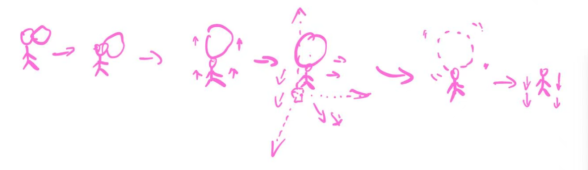

```
手持泡泡 → 蓄力变大 → 包裹角色上浮 → 可控方向移动 → 泡泡消失 → 角色下落
```

| 步骤 | 说明 |
|------|------|
| 1 | 手持泡泡 |
| 2 | 蓄力，泡泡变大 |
| 3 | 泡泡包裹角色，**开始上浮** |
| 4 | **可控方向移动**（前后左右都能调整） |
| 5 | 5 秒到，泡泡消散 |
| 6 | 角色下落 |

> **特点**：全程可控，但时间有限。适合**精确位移**。

### 泡泡空间漂浮（流程）

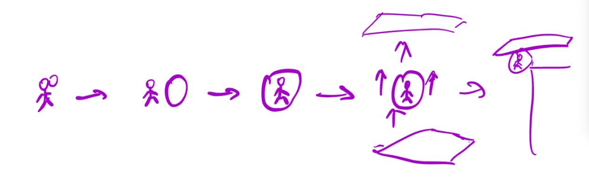

```
手持泡泡 → 放置（人泡分离）→ 进入泡泡空间 → 向上飘 → 到达顶部黏合固定 → 站上去
```

| 步骤 | 说明 |
|------|------|
| 1 | 手持泡泡 |
| 2 | **放置**（人与泡泡分离） |
| 3 | 角色**进入泡泡空间** |
| 4 | 泡泡**向上飘**（角色随之上浮） |
| 5 | 飘到上方结构，**黏合固定** |
| 6 | 角色**站到黏合后的泡泡上** |

> **特点**：时间无限，但**只能向上**、不能主动停。
> **落点由关卡布局决定**——这正是 Z 轴闸门能成立的原因。

#### ⚠️ Z 轴闸门（关卡设计保护）

> **这是本作最重要的关卡约束之一。**

给玩家 Z 轴能力，会破坏所有基于 XY 平面的关卡设计。
**必须加闸门**，否则关卡设计失控。

| 闸门 | 作用 |
|------|------|
| 蓄力漂浮**限时 5 秒** | 飞不远，无法横跨整个关卡 |
| 泡泡空间**只能向上** | 不能自由悬停、不能主动下降 |
| 泡泡空间**靠黏合终止** | 落点由**关卡布局**决定，不由玩家决定 |
| 黏合**不可逆** | 用过就不能改，一次性的承诺 |

**设计意图**：

> 玩家能上 Z 轴，但**每次上升都是一次有去无回的承诺**。
>
> 落点不是"我想去哪就去哪"，而是"**关卡允许我去哪**"。
> 这样 Z 轴就变成了**关卡设计的一部分**，而不是破坏关卡的工具。

#### 终态：黏合

两种漂浮**最终都会进入黏合态**——接触其他泡泡后固定不动，**永久失去浮粘能力**。

| 状态 | 行为 | 用途 |
|------|------|------|
| **漂浮态** | 向上浮（两种方式） | 载玩家上升 |
| **黏合态** | 固定不动，失去浮粘能力 | 连接成桥、锚定位置 |

> **黏合后原地固定**——这意味着**桥可以悬空**，
> 玩家可以用浮粘泡泡在高处搭建通路。

### 爆炸泡泡（旧稿称“炸弹泡泡”）

| 项 | 内容 |
|----|------|
| **能力** | 玩家可控爆炸，提供与大小相关的**向外力**；主动引爆、碰撞触发、组合触发方式待确认 |
| **质量** | 质量大，可用于配重，组合惯性可能将玩家甩飞 |
| **泡泡空间** | — |
| **释放** | 旧方案为放置（或放入泡泡空间），具体输入待确认 |
| **典型用途** | 改变运动、组合位移与解谜；压机关、爆破障碍为旧延伸方向 |
| **资源** | 爆炸消耗泡泡值；不产生补给，须靠破坏其他可破坏泡泡补回 |
| **旧限制候选** | 一次控制一枚，是否沿用待确认 |

#### 爆炸推力：位移工具

**炸弹不只是"破坏"——它产生一个力，能改变运动方向。**

参考《旷野之息》的炸弹：**爆炸把物体/角色推向某个方向**。

```
        爆炸前              爆炸后
          ●                  ↗
         ／                  ●  ← 被推出去
        💥                  ／
       静止              改变方向
```

| 用途 | 说明 |
|------|------|
| **改变方向** | 角色/物体在运动中，被爆炸推向新方向 |
| **加速** | 朝运动方向爆炸，获得额外推力 |
| **制动** | 反向爆炸，减速或停下 |
| **弹射** | 与弹力泡泡组合，形成**二次弹射** |

> **设计价值**：这让炸弹从"一次性道具"变成了**空中控制手段**。
>
> 玩家在跳跃/飞行途中引爆，可以**实时修正轨迹**——
> 这打开了大量空间玩法，也是"三种泡泡组合"的关键一环。

> ⚠️ 爆炸推力**对玩家自身也生效**（这是它能当位移工具的前提）。
> 需要确认：是否会对玩家造成伤害？（见待确认项）

## 4.2 三种泡泡的相互影响

**这是本作涌现的核心来源。**

```
弹力 × 浮粘 = 弹上去，浮住
弹力 × 炸弹 = 弹射出去，空中爆炸二次修正方向
浮粘 × 炸弹 = 炸开后被浮粘托起
三种组合   = 见 4.4 组合玩法举例
```

> 单独看每种泡泡都很简单，**组合起来玩家无法穷举**。

### 浮粘旧方案：黏合为“接触即触发”（待确认）

**浮粘泡泡与任何泡泡接触，就会黏合并失去浮粘能力**——这个判定是**自动的**，不需要玩家按键。

```
浮粘泡泡  ──接触──→  弹力泡泡 / 炸弹泡泡 / 另一个浮粘泡泡
                          ↓
                    自动黏合，固定不动，失去浮粘能力
```

**这意味着玩家必须小心摆放**：

| 想要的效果 | 必须避免 |
|-----------|---------|
| 让它浮上去 | 别让它碰到别的泡泡 |
| 让它粘成桥 | 主动让它接触 |

> **设计价值**：这条规则让"摆放位置"本身成为解谜的一部分。
> 玩家不能无脑乱放——**一次误触就永久改变了这个泡泡的性质**。

**涌现示例**：
- 浮粘泡泡粘住弹力泡泡 → 弹力泡泡被"锚定"在原地，成为稳定的弹射点
- 浮粘泡泡粘住炸弹泡泡 → 炸弹被固定住，可以精确控制爆炸位置
- 多个浮粘泡泡互相黏合 → 形成一条**悬空的桥**

### 旧方案：黏合是 Z 轴的“着陆机制”（待确认）

**泡泡空间漂浮只能向上，玩家无法主动停止**——
**黏合就是唯一的刹车**。

```
泡泡空间漂浮中  →  碰到泡泡  →  黏合固定  →  玩家站在这里
      ↑                                          ↓
   只能向上                                这就是落点
```

> **这条规则把"落点决定权"从玩家交给了关卡设计者。**
>
> 玩家能选择"什么时候上升"，但**不能选择"在哪里停"**——
> 停在哪里，取决于关卡的泡泡布局。
>
> 这正是 Z 轴闸门能成立的原因：**上升是自由的，落点是被设计的。**

> ⚠️ 黏合是**不可逆**的。这带来决策压力，也让"误操作"产生后果。

## 4.3 泡泡空间

**三种泡泡都能创建泡泡空间**——这是统一的底层机制。

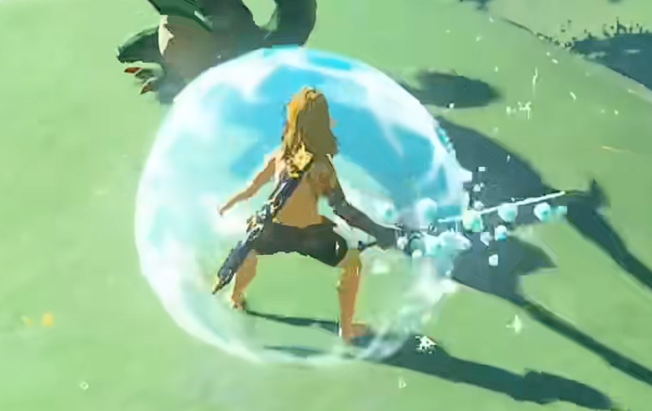
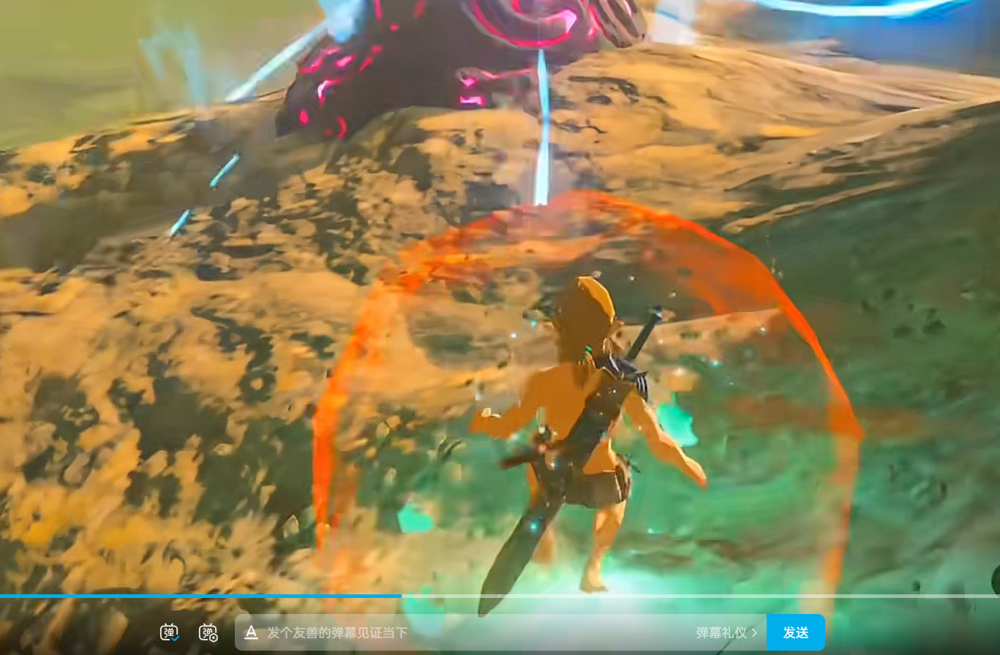

| 项 | 内容 |
|----|------|
| **形态** | 半透明球体，有边缘光晕，内部可见 |
| **颜色** | 按泡泡类型区分（弹力 / 浮粘 / 炸弹） |
| **作用** | 进入后获得对应效果 |
| **入口** | 玩家走进去，或泡泡包裹玩家 |

**设计要点**：三种泡泡共享"创建空间"这一底层机制，
**不是三套独立系统**——这保证了机制的咬合。

## 4.4 组合玩法举例

> ⚠️ **本节只举一个例子，不是全部解法。**
> 目的是说明"三种泡泡组合"能产生什么，而不是穷举玩法。

### 示例：三段式空中弹射

**用三种泡泡组合，把角色送上原本到不了的高处。**

```
① 浮粘泡泡        ② 弹力泡泡          ③ 炸弹泡泡
   连接成平台        弹射出去             空中二次弹射
                                                    ↗
   (○)-(○)    →     ↗  ●  →→→    →     💥 ●
                     ／                  修正方向
```

| 步骤 | 用哪个泡泡 | 做什么 |
|------|-----------|--------|
| ① | **浮粘泡泡** | 两个浮粘泡泡黏合，在高处搭一个**落脚平台** |
| ② | **弹力泡泡** | 站在平台上，用弹力泡泡**把自己弹射出去** |
| ③ | **炸弹泡泡** | 在空中引爆，**二次修正方向**，落到更远/更高的地方 |

**关键点**：

- ① 浮粘泡泡提供**起点高度**（Z 轴闸门 → 靠黏合固定）
- ② 弹力泡泡提供**初始速度**（弹射）
- ③ 炸弹泡泡提供**空中修正**（爆炸推力改变方向）

> **三段缺一不可**——这正是"组合产生复杂度"的体现。
>
> 玩家不是学会了三个工具，而是学会了**把它们串起来**。

### 为什么这个例子重要

它展示了本作的核心设计意图：

| 单独看 | 组合起来 |
|--------|---------|
| 浮粘 = 搭桥 | 浮粘 + 弹力 + 炸弹 = **到达任意位置** |
| 弹力 = 弹跳 | |
| 炸弹 = 破坏 | |

> **玩家无法一次性穷举**——因为组合数远大于机制数。
> 这就是"少即是多"。

> 💡 **关卡设计提示**：这个例子可以作为**第 4 关（组合）**的核心谜题。
> 但不要直接教"三段式"——让玩家自己摸索出这条链。

---

# 五、输入与释放

> **本章操作映射为保留的旧原型候选**：蓄力是当前确认的操作机制，但具体键位、飞行控制和爆炸触发方式待定；不将 F / A 引爆或右键释放直接写成跨平台定案。破坏补充与资源不足提示须补充（D01）。

## 5.1 蓄力释放

```
左键长按蓄力 → 泡泡变大 → 右键释放
```

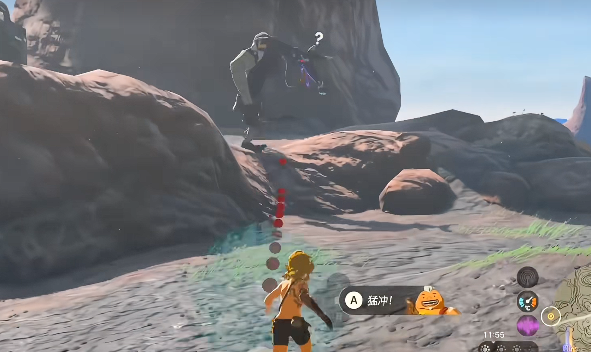

| 步骤 | 操作 | 效果 |
|------|------|------|
| 1 | **左键长按** | 开始蓄力，泡泡逐渐变大 |
| 2 | 蓄力中 | 泡泡越大 → **能力强度越高** |
| 3 | **右键** | 释放出去 |

## 5.2 大小决定强度

**一个输入维度，同时控制三件事：**

```
长按越久 → 泡泡越大 → 能力越强
```

| 泡泡 | 越大则 |
|------|--------|
| 弹力 | 弹得越远 / 破坏力越强 |
| 浮力 / 黏合 | 包裹阈值与结构效果待确认 |
| 爆炸 | 本版确认**向外力与大小相关**；爆炸力曲线与范围另行确认 |

> **玩家每一次点击都在做一个连续的权衡**——蓄多久？
> 这是"少即是多"的又一次应用：**一个输入，三种能力，无限组合**。

### 浮力泡泡包裹阈值（TBD）

浮力泡泡达到一定大小后可包裹玩家飞行；具体尺寸/体积指标与阈值为 **T05**。

旧稿“大于角色 2 倍，可控飞行 5 秒”保留为测试候选，不作为本版定案。蓄力大小、飞行控制、时长与资源消耗应分别确认，不能仅以“蓄满”作为已锁定的使用条件。

## 5.3 释放方式

| 泡泡 | 可发射 | 可放置 |
|------|--------|--------|
| **弹力泡泡** | ✅ | ✅ |
| **浮力泡泡** | ❌ | ✅（旧放置候选，控制待定） |
| **爆炸泡泡** | ❌ | ✅（旧放置候选，触发待定） |

## 5.4 引导线

释放时显示**瞄准引导线**（见图三）：

- 从主角发出的虚线
- 末端有落点标记
- 蓄力时线条随泡泡大小变化

## 5.5 操作映射

### 键鼠

| 操作 | 按键 |
|------|------|
| 移动 | WASD |
| 视角 | 鼠标 |
| 蓄力 | 鼠标左键长按 |
| 释放 | 鼠标右键 |
| 切换泡泡 | 数字键 1-3 / 滚轮 |
| 控制爆炸 | 旧主动引爆候选：专用键（如 F）；具体触发方式 TBD |
| 暂停 | ESC |

### 手柄

| 操作 | 按键 |
|------|------|
| 移动 | 左摇杆 |
| 视角 | 右摇杆 |
| 蓄力 | LT 长按 |
| 释放 | RT |
| 切换泡泡 | LB / RB |
| 控制爆炸 | 旧主动引爆候选：A；具体触发方式 TBD |
| 暂停 | Start |

---

# 六、泡泡值资源系统

> **泡泡值是玩家资源。** 泡泡值只有一个来源：**破坏可破坏的泡泡**。**没有回收机制。**
> 本章区分「破坏补充」（赚）与「爆炸消耗」（花），不把爆炸写成永久损失。

## 6.1 泡泡值的来源

| 项 | 本版规则 |
|----|----------|
| 玩家资源 | **泡泡值**，所有泡泡能力从中支出。 |
| 唯一来源 | **破坏可破坏的泡泡**（粉色泡泡等）时，泡泡值回升。 |
| 无回收 | 不存在"回收已发射泡泡"的机制；泡泡值不会从已发射的泡泡里返还。 |
| 上限与效率 | 泡泡值上限、每次破坏的回复量为 TBD（T04）。 |

**命名**：使用"泡泡值""破坏补充""爆炸消耗"。不再使用"泡泡液""回收""不可回收消耗"。

## 6.2 破坏补充 与 爆炸消耗

| 行为 | 泡泡值 | 说明 |
|------|--------|------|
| **破坏可破坏泡泡** | ↑ 回升 | 泡泡值的唯一来源。**破坏 = 赚。** |
| **发射普通泡泡** | ↓ 花掉 | 弹力 / 浮力泡泡的发射消耗。 |
| **爆炸泡泡** | ↓ 大幅花掉 | 纯消耗，不产生补给，须靠破坏其他泡泡补回。 |

```
破坏粉色泡泡  →  泡泡值回升        （赚）
发射泡泡      →  泡泡值下降        （花）
爆炸          →  泡泡值大幅下降    （花，不补给）
```

**设计意图**：把"维持资源"和"推进关卡"绑成同一件事——想继续用泡泡，就得继续破坏泡泡。
**破坏不是消耗，是补给。**

**第一关教学**：玩家破坏一定数量泡泡后，提示"泡泡值有限，破坏可破坏的泡泡可以补充"，引导玩家观察泡泡值回升；不能以"等待自动回复"替代本次教学。触发数量为 T02。

## 6.3 旧扩展方案：泡泡潮补给

旧稿保留"泡泡潮与补给联动"的方向，**本次未确认其是否启用**。

| 项 | 保留方向 / 待确认 |
|----|-------------------|
| 补给触发 | 泡泡潮被破坏时是否额外补给、哪些类型有效。 |
| 旧平衡方向 | 回复与释放成本形成权衡；旧数值口径不一致，需统一。 |
| 有限性 | 若启用，需说明每个泡泡体的补给容量和愈合后是否补充，避免无限刷取。 |
| 教学定位 | 不作为第一关破坏补充教学的替代。 |

## 6.4 破坏补充的呈现与边界

| 项 | 状态 |
|----|------|
| 补充方式 | 破坏泡泡时自动回升，还是需要额外操作，为候选；操作、范围、目标选择为 TBD（D01）。 |
| 补充效率 | TBD；不默认百分之百，也不预设比例。 |
| 黏合态普通泡泡 | 破坏条件、是否拆解连接体、结构反馈为 TBD。 |
| 已发射泡泡自动消散 | 保留旧"定时消散以控制场景数量"候选；时长及消散时的泡泡值结算需确认。 |
| 蓄力取消 / 未引爆爆炸泡泡 | 资源结算和处置方式待确认。 |

## 6.5 UI 表现

| 元素 | 表现要求 |
|------|----------|
| 泡泡值指示 | 常驻显示当前可用量；样式沿用泡泡形态，容量数值待定。 |
| 蓄力预览 | 显示泡泡大小变化与预计资源支出，力度曲线不在 UI 中预设为线性。 |
| 破坏补充反馈 | 破坏泡泡时泡泡值回升的即时反馈；让因果清楚。 |
| 爆炸消耗 | 爆炸时泡泡值下降，无回升提示，与破坏补充区分。 |
| 资源不足 | 提示不能施放，并提示可去破坏泡泡补充；不暗示永久死亡。 |

## 6.6 资源不足与失败返回

**泡泡值归零是暂时能力受限，不等于只能重开。**

```
泡泡值不足 → 暂时不能释放所需泡泡
                 ↓
附近有可破坏泡泡：破坏补充
没有可破坏泡泡：寻找补给 / 等待关卡补给设计
                 ↓
资源满足要求 → 继续操作
```

玩家仍可移动；重开作为自愿选项保留。若附近没有可破坏目标，须在关卡补给设计中解决，不能仅凭本规则宣称任何场景永远可解。

**空间失败**：掉入空洞返回房间初始点；诞生泡泡体是最初存档点。返回时泡泡、连接体、泡泡值、墙体愈合及教学进度如何重置，统一列为 TBD。

**旧惩罚设计对照**：

| 维度 | 本版处理 / 保留候选 |
|------|---------------------|
| 空间失误 | 掉入空洞返回房间初始点，不是永久死亡。 |
| 资源失误 | 破坏可破坏泡泡补充；旧"软死亡只能重开"口径不再作为现行规则。 |
| 时间压力 | 泡泡潮保留为旧扩展候选；是否启用及失败处理待确认。 |

## 6.7 旧扩展方案：增值泡泡潮

**保留旧设计，不是本次第三关的必验收项**。是否从第三关出现、启动时机与节奏待确认；若加入，应在核心爆炸教学完成后再引入压力，不能迫使玩家跳过资源和物理反馈。

| 项 | 旧方案 |
|----|--------|
| 起点与运动 | 箱庭角落不断分裂扩展，向地图中心推进、压缩活动空间。 |
| 触发 | 玩家进入房间才启动，房间外可观察与准备。 |
| 应对 | 可以移动摆脱、破坏局部，但无法根除。 |
| 补给联动 | 若同时启用，可保留"边逃边打补资源"；补给规则仍待确认。 |
| 能力组合 | 弹力脱离、浮力/黏合搭高台及爆炸改变运动可作为应对方向。 |
| 追上后果 | 旧稿为失败；返回点、重置范围与通用失败规则的关系待确认。 |
| 数值 | 扩散速度、密度、威胁范围与回复量待调优。 |

**设计意图保留**：以看得见的逼近威胁表达时间压力，而不是额外 HUD 倒计时；打掉部分只争取时间，不把它变成可彻底清除的静态障碍。

## 6.8 参数状态与旧测试基准

**本版不确定新数值**。T01–T09 的最新状态统一见 §15。

### ✅ 已确认数值（v2.30）

> 完整规格见 [4.0.9 数值规格](#409-数值规格v230-确认)

| 项 | 值 |
|----|-----|
| **泡泡值上限** | **100** |
| **消耗范围** | **2 - 12**（只看体积） |
| **关卡时长** | **3 - 5 分钟** |
| **恢复公式** | 恢复值 ≈ 容积 × **1.5** |

**六种场景泡泡**：

| 泡泡 | 容积 | 恢复值 | 复原时间 | 净收益 |
|------|------|--------|---------|--------|
| 普通泡泡 | 6 | 9 | 20 秒 | +3 |
| 弹性泡泡 | 12 | 18 | 20 秒 | +6 |
| 脆弱泡泡 | 2 | 3 | 不复原 | +1 |
| 补给泡泡 | 2 | 15 | 45 秒 | **+13** |
| 硬化泡泡 | 24 | 36 | 35 秒 | +12 |
| 复合泡泡 | 30 | 45 | 35 秒 | +15 |

> **设计目标**：**资源不吝啬，鼓励多用泡泡能力。压力来自时间，不来自资源短缺。**

### 关卡倒计时（v2.30 确认）

| 项 | 值 |
|----|-----|
| **关卡时长** | **3 - 5 分钟** |
| **超时后果** | **泡泡潮从角落逼近** |
| 与复原时间关系 | 复原时间 = 关卡时长 ÷ 5~12 |

### 旧测试基准

| 旧稿基准 | 旧数值 / 方向 | 本版状态 |
|----------|---------------|----------|
| 泡泡值上限 | 100 | 旧测试基准；上限重新列为 TBD。 |
| 不蓄力小泡泡消耗 | 1 | **已被 2-12 范围取代**。 |
| 单次蓄力消耗上限 | 10 | **已被 2-12 范围取代**（上限为 12）。 |
| 蓄力资源消耗曲线 | 线性递增 | 旧候选；与蓄力时间—力度曲线分开确认。 |
| 破坏回复 | 8 / 50 | 旧"破坏回复"候选；启用与平衡待确认。 |
| 破坏需求 | 8 个小泡泡或 1 个蓄力量至少 8 的泡泡 | 旧测试候选，不作为首次破坏教学的锁定数值。 |
| 小泡泡破坏回复 | 按容积折算且比例递减 | 旧候选。 |
| 泡泡潮回复 | 容积基础 + 1 | 旧扩展候选，非当前补给定案。 |

**需要分别测试**：破坏回复效率、爆炸消耗量、墙体恢复时间、浮力包裹阈值、蓄力力度曲线、爆炸力曲线。自动消散和返回重置的资源结算确认后，才能判断完整资源闭环。

---

# 七、核心循环

## 7.1 操作循环

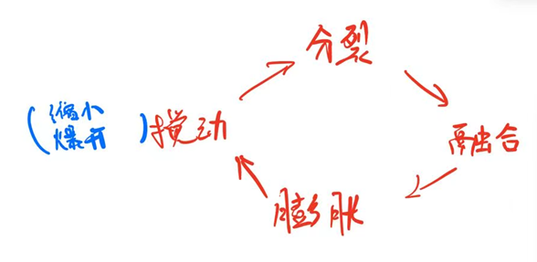

## 7.2 通关循环

**玩家目标**：让关卡的阻挡物（泡泡）**短暂打开**，然后通过。

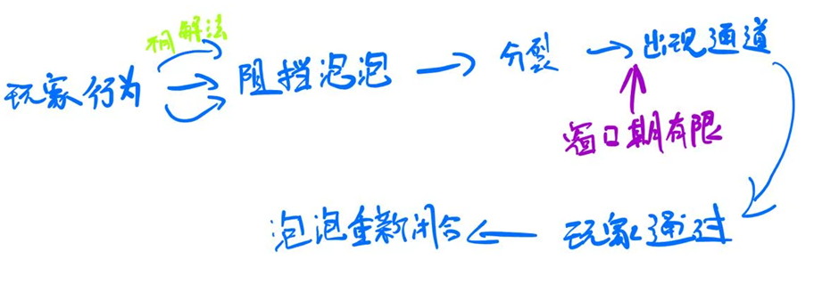

> **关键**：分裂是**暂时的**，融合会把它合上。
> 这带来时间压力，也让"通过"变成需要判断的决策。

## 7.3 叙事循环

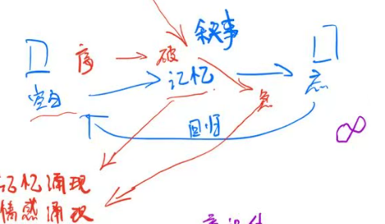

**总循环**：

```
结构操作 → 新现象 → 记忆显现 → 理解意义 → 世界改变 → 新空白 → 再次操作
```

---

# 八、关卡设计

> **结构保留**：1–3 关为教学关，4–5 关为综合运用关；本次完善前三关，不替第四/五关补定解法。
> 前三关采用白色主色调、少量可交互类型；每次先让玩家操作并看见反馈，再命名机制并释放自由。旧扩展方案不混入本次核心验收。

## 8.1 总览

| 关 | 类型 | 主题 | 核心教学 / 考验 | 关键环境 |
|----|------|------|------------------|----------|
| 1 | 教学 | **弹力** | 首次破坏、移动解锁、有限资源、破坏补充、蓄力、前置材料 | 粉色泡泡墙、诞生泡泡体 |
| 2 | 教学 | **黏合（浮力）** | 泡泡连接体、自制工具、失败返回、包裹飞行 | 巨大空洞、顶部黏合泡泡群、记忆远景 |
| 3 | 教学 | **爆炸** | 组合物理、爆炸消耗、质量惯性、可控爆炸、大小相关向外力 | 定向移动泡泡、爆炸陷阱、空洞 |
| 4 | 正式 | 组合 | 三种泡泡综合运用，待细化 | 混合 |
| 5 | 正式 | 共鸣 | 全部机制与叙事收束，待细化 | 全部 |

## 8.2 世界基础：粉色泡泡与前置材料

| 属性 | 本版规则 |
|------|----------|
| 可破坏 | 粉色泡泡（墙）是主要障碍物，可用弹力泡泡破坏。 |
| 会恢复 | 过一定时间后恢复；恢复时间为 T01。保留“分裂 → 膨胀 → 融合”的愈合表现，使过程可见。 |
| 前置材料 | 弹力泡泡本身是粉色泡泡的前置泡泡，可用于构建、生成或转化出世界材料。 |
| 初始存档 | 诞生泡泡体为主角诞生点与最初存档点。 |

**工具即材料**：弹力泡泡不仅破坏障碍，也为构建泡泡世界提供基础材料。具体转化条件与操作待细化，不能把“发射后立即变墙”写成已确认步骤。

**规则区分**：墙体恢复是环境愈合；泡泡值靠破坏可破坏的泡泡补充。旧泡泡潮补给和爆炸永久破坏方案见 §3、§6.3，不据此断言关卡永远可解。

## 8.3 教学关设计原则

```
限制行动 → 玩家操作 → 系统反馈 → 机制命名 → 解锁自由
```

- **限制**只收束当前学习焦点；第一关明确限制移动并采用固定视角，第二/三关不自动沿用移动锁定。
- **操作先行**：给玩家足够清楚的对象与行动目标，先产生实际效果。
- **反馈可读**：破坏、资源变化、破坏补充、连接、包裹、受力分别有可辨认反馈。
- **命名克制**：行为反馈为主，允许简短资源提示与机制命名，不要求绝对零文字。
- **解锁明确**：获得自由后提供练习与独立考核，不强制唯一组合解法。
- **验收基于行为**：检查玩家是否能独立操作并理解因果，而非仅看到提示或到达出口。

## 8.4 第 1 关：弹力

**主题**：弹力、破坏、破坏补充、蓄力、材料认知。

### 环境

白色为主，少量可交互类型，主要对象为可破坏、会恢复的粉色泡泡墙。诞生泡泡体位于起点，作为主角诞生点和最初存档点。

### 引导序列

| 顺序 | 阶段 | 玩家操作与系统反馈 | 机制命名 / 解锁 |
|------|------|-------------------|-----------------|
| 1 | 限制行动与首次破坏 | 固定视角、限制移动；玩家破坏面前第一个粉色泡泡；明确表现破坏成功。 | 反馈成功后解锁自由移动，不提前解除限制。 |
| 2 | 资源有限与破坏补充 | 玩家破坏一定数量泡泡后提示“泡泡值有限，破坏可破坏的泡泡可以补充”；引导玩家破坏泡泡、观察泡泡值回升。 | 命名“破坏补充”，建立“消耗 → 破坏 → 补充”因果；触发数量为 T02。 |
| 3 | 蓄力机制 | 引导蓄力，并对比不同蓄力下的泡泡大小、力度或破坏效率。 | 命名“蓄力”；时间与效果曲线为 T03，不锁定具体表现参数。 |
| 4 | 弹力泡泡的双重属性 | 展示弹力泡泡可破坏粉色泡泡，同时是粉色泡泡的前置材料。 | 建立“既是工具，也是建材/前置形态”的认知，具体转化操作待细化。 |

### 关卡验收

| 编号 | 验收条件 |
|------|----------|
| L1-01 | 玩家完成首次破坏；系统在成功反馈之后解锁自由移动。 |
| L1-02 | 玩家理解泡泡值有限，并通过破坏可破坏的泡泡观察到泡泡值回升。 |
| L1-03 | 玩家独立完成蓄力操作，能辨认与未蓄力相比的效果差异。 |
| L1-04 | 玩家理解弹力泡泡既可破坏粉色泡泡，也是其前置材料，而非两种无关物件。 |
| L1-05 | 粉色泡泡的恢复过程可见；诞生泡泡体被明确识别为最初存档点。 |

**相关 TBD**：T01–T04；破坏补充提示、资源不足提示、取消蓄力及前置材料转化操作另见 §15。

## 8.5 第 2 关：黏合（浮力）

**主题**：黏合、连接体、浮力飞行、空洞跨越。

### 环境

面前是一片巨大空洞，阻挡前往下一个记忆空间的道路。顶部有可粘住泡泡的黏合泡泡群，玩家可窥见记忆泡泡世界的部分景观；远景不抢占教学对象的辨识度。

### 引导序列

| 顺序 | 阶段 | 玩家操作与系统反馈 | 机制命名 / 学习结果 |
|------|------|-------------------|---------------------|
| 1 | 泡泡连接体 | 引导玩家通过黏合等方式拼接多个泡泡，看到结构形成，并用于移动、支撑或搭建。 | 命名“泡泡连接体”；它是玩家自己制作的通关工具。 |
| 2 | 空洞障碍与失败规则 | 玩家需要跨越空洞；若掉落，返回房间初始点。 | 明确空洞是失败区，但非永久死亡；具体返回位置及重置范围为 T09。 |
| 3 | 浮力泡泡 | 泡泡达到一定大小后包裹玩家并飞行，利用飞行跨越障碍。 | 命名“浮力泡泡”；阈值为 T05，控制、持续、退出与黏合落点方式待定。 |

### 关卡验收

| 编号 | 验收条件 |
|------|----------|
| L2-01 | 玩家实际搭建泡泡连接体，并理解它是自制通关工具。 |
| L2-02 | 发生空洞掉落时返回房间初始点；玩家理解可重新尝试，重置范围按后续定案验证。 |
| L2-03 | 玩家使浮力泡泡达到包裹阈值，完成包裹飞行并跨过空洞。 |
| L2-04 | 连接体、包裹与飞行的因果反馈清楚，不依靠照抄唯一预设结构才通关。 |

**相关 TBD**：T04、T05、T09；黏合规则与飞行控制候选另见 §4、§15。

## 8.6 第 3 关：爆炸

**主题**：爆炸、物理组合、爆炸消耗、可控爆炸。

### 环境

存在大量定向移动的泡泡实体，以及会爆炸的泡泡陷阱。陷阱会将玩家推向空洞；玩家进入本关前已具备飞行能力，可在组合与运动中预判风险。

### 引导序列

| 顺序 | 阶段 | 玩家操作与系统反馈 | 机制命名 / 学习结果 |
|------|------|-------------------|---------------------|
| 1 | 组合与物理效果 | 利用泡泡组合搭建独特效果，展示运动、支撑、推力或配重结果。 | 强调真实物理关系，不做与运动无关的抽象答案匹配。 |
| 2 | 爆炸消耗 | 爆炸泡泡消耗泡泡值且不产生补给；引导玩家破坏其他泡泡补回。 | 使用“爆炸消耗”；消耗量与补回效率为 T06、T07。 |
| 3 | 质量与甩飞 | 大质量爆炸泡泡与其他泡泡组合，可能通过惯性将玩家甩飞。 | 建立质量、惯性与组合物理的关系，不能只展示爆炸特效。 |
| 4 | 可控爆炸 | 玩家控制爆炸并观察受力；主动引爆、碰撞触发、组合触发均为候选，具体方式待定。 | 玩家可控与环境陷阱需可辨认，不预先锁定引爆键或单枚上限。 |
| 5 | 爆炸力与大小 | 爆炸产生向外力，对比不同大小泡泡的作用差异。 | **爆炸力 = f(泡泡大小)**；曲线为 T08，不默认线性、平方或体积关系。 |

### 关卡验收

| 编号 | 验收条件 |
|------|----------|
| L3-01 | 玩家利用爆炸向外力与泡泡组合完成移动或解谜，不只完成一次爆破。 |
| L3-02 | 玩家理解爆炸消耗泡泡值且不产生补给；能够通过破坏其他泡泡补回。 |
| L3-03 | 大质量与组合惯性可被感知；玩家能够辨认甩飞与直接爆炸推力的不同来源。 |
| L3-04 | 玩家通过最终确认的触发方式控制爆炸，能将自己的爆炸与环境陷阱区分。 |
| L3-05 | 玩家理解爆炸力与泡泡大小相关；不同大小的受力差异可读。 |
| L3-06 | 被陷阱推入空洞时遵循房间初始点返回规则，不误作永久死亡。 |

**旧扩展保留**：增值泡泡潮仍见 §6.7；是否加入第三关与启动时机待确认，不作为本次核心验收项，也不能抢在以上教学反馈之前施加时间压力。

**相关 TBD**：T04、T06–T09；爆炸触发方式、并发数量、是否伤害玩家另见 §15。

---

## 8.7 第 4 关：组合（正式关卡）

**教学目标**：三种泡泡的综合运用。

> ⚠️ **待细化**——需要团队提供具体设计。

| 方向 | 说明 |
|------|------|
| 核心 | 三种泡泡**互相影响**，产生玩家没预料到的结果 |
| 参考 | 见 4.4 组合玩法举例的"三段式空中弹射" |
| 难度 | 从教学关的"单一解法"过渡到"多解" |

---

## 8.8 第 5 关：共鸣（正式关卡）

**教学目标**：全部机制综合 + 叙事收束。

> ⚠️ **待细化**——需要团队提供具体设计。

| 方向 | 说明 |
|------|------|
| 核心 | 综合运用全部机制 |
| 叙事 | 与剧情高潮同步（见第九章） |
| 收束 | 引出"放弃记忆"的结局 |

---

## 8.9 关卡递进关系

```
第 1 关  首次破坏 / 破坏补充 / 蓄力 → "我能改变世界，也能管理资源"
   ↓
第 2 关  连接体 / 包裹飞行    → "我能创造通关工具"
   ↓
第 3 关  质量 / 爆炸 / 组合   → "泡泡之间有物理关系，消耗也有不同后果"
   ↓
第 4 关  三种组合      →  "组合产生意想不到的结果"
   ↓
第 5 关  综合 + 叙事   →  "我在重建的，是我自己"
```

**玩家的成长曲线**：

| 阶段 | 玩家身份 |
|------|---------|
| 1 关 | **使用者**——认识工具与有限资源 |
| 2–3 关 | **创造者**——连接成工具，组合出物理效果 |
| 4-5 关 | **重建者**——意识到自己一直在重建记忆 |

---

# 九、剧情设计

> ⚠️ **本章为后续版本目标，v1 不实现。**
>
> v1 的 5 个教学关**只埋伏笔、不讲完整故事**。

## 9.1 情感内核

> **主角是"家"的最后一段记忆。**
> 它必须放弃自己，才能让被留下的人继续活下去。

## 9.2 角色

*（待补充）*

## 9.3 剧情

*（待补充）*

---

# 十、美术设计

## 10.1 风格

> ⚠️ **v2.14 重大转向**：画风从"斯普拉遁粗描边霓虹"改为**手绘厚涂**。

| 项 | 内容 |
|----|------|
| 画风 | **手绘厚涂** |
| 维度 | **3D** |
| 统一原则 | **一切皆泡泡**（主角为蓝色水母造型） |

### 手绘厚涂的视觉特征

| 项 | 要求 |
|----|------|
| 笔触 | **可见的手绘笔触**，不追求平滑 |
| 质感 | 颜料堆积感、色彩交融、边缘柔和 |
| 光影 | 柔和的体积感，非硬边赛璐璐 |
| 线条 | **弱化描边**（与上一版相反） |
| 氛围 | 温暖、朦胧、有"手作感" |

> **与上一版的区别**：
> | | 斯普拉遁风（旧） | 手绘厚涂（新） |
> |---|---|---|
> | 描边 | 极粗黑线 | **弱化/无** |
> | 色彩 | 霓虹撞色 | **柔和过渡** |
> | 质感 | 硬边赛璐璐 | **厚涂颜料感** |
> | 气质 | 街头朋克 | **温暖治愈** |

## 10.2 色彩

> **v2.25 适用边界**：前三关教学房间以白色为主，功能泡泡和危险反馈少量点缀。以下粉紫、水青色板与火山旅梦参考保留，用于记忆世界远景、后续空间及既有角色资产；“粉紫占 60%”“第 2 关起大量水青”的旧比例方向不适用于当前前三关主画面。

> **基调参考：《明日方舟》「火山旅梦」活动——粉紫梦幻基调**
>
> 详见 [10.2.1 参考图](#1021-参考图)。

### 主色板

**核心三色：粉 / 紫 / 青**——粉紫为基调，青为对比。

| 色名 | 色号 | 环境用途 | **泡泡墙用途** |
|------|------|---------|---------------|
| **云粉** | `#F5C6D8` | 天空、光晕、氛围 | **普通可破坏墙**——最常见的基础墙体 |
| **雾紫** | `#B48BC4` | 深度、远景、梦幻感 | **不可破坏墙**——边界、需要绕行的障碍 |
| **水青** | `#7ED4D4` | 水面、冷调对比、通透感 | **弹性墙**——可弹跳、可穿过的材质 |

### 扩展色板

| 色名 | 色号 | 环境用途 | **泡泡墙用途** |
|------|------|---------|---------------|
| **霞粉** | `#FFE0EC` | 高光、云层、柔光 | 普通墙的**高光面** |
| **藕荷** | `#D9A8D0` | 粉紫过渡 | 普通墙的**阴影面** |
| **深紫** | `#6B5B8C` | 远景、阴影、天空深处 | 不可破坏墙的**阴影面** |
| **夜紫** | `#4A3F6B` | 最深处、深渊 | **深渊 / 虚空边界** |
| **暖橙** | `#FFB87C` | 暖光、火光、强调点 | **爆炸墙**——会爆炸的危险泡泡 |
| **珊瑚** | `#FF9E9E` | 珊瑚元素、暖色点缀 | **脆弱墙**——一碰就碎 |
| **深海青** | `#3A8FA0` | 水下阴影、深度 | 弹性墙的**阴影面** |
| **云白** | `#FAF6F8` | 呼吸空间、高光 | **未激活 / 空状态** |
| **岩灰** | `#8B8FA3` | — | **硬化泡泡**（仅爆炸可破） |
| **琥珀** | `#E8A33D` | — | **复合泡泡**（需叠加破坏） |
| **青绿** | `#6BC9A8` | — | **弹性泡泡**（可弹跳/穿过） |
| **玫红** | `#E8478B` | — | **连锁泡泡**（后续） |
| **银蓝** | `#9BC4E2` | — | **镜像泡泡**（后续） |
| **墨黑** | `#3A3A4A` | — | **吞噬泡泡**（后续） |
| **紫罗兰** | `#A67BD9` | — | **共鸣泡泡**（后续） |

### 六种场景泡泡配色表

> 见 [4.0 六种场景泡泡](#40-六种场景泡泡)

| 泡泡 | 颜色 | 色号 |
|------|------|------|
| 普通泡泡 | 云粉 | `#F5C6D8` |
| 硬化泡泡 | 岩灰 | `#8B8FA3` |
| 复合泡泡 | 琥珀 | `#E8A33D` |
| 补给泡泡 | 水青 | `#7ED4D4` |
| 弹性泡泡 | 青绿 | `#6BC9A8` |
| 脆弱泡泡 | 珊瑚 | `#FF9E9E` |

### 泡泡墙材质配色表

> ⚠️ **不同功能的墙用不同配色**——玩家一眼就能判断这是什么墙。

| 材质 | 主色 | 色号 | 特征 | 玩法 |
|------|------|------|------|------|
| **普通墙** | 云粉 | `#F5C6D8` | 半透明粉，柔和 | **可破坏**，会愈合 |
| **不可破坏墙** | 雾紫 | `#B48BC4` | 深紫，厚重感 | **无法破坏**，关卡边界 |
| **弹性墙** | 水青 | `#7ED4D4` | 半透明青，有弹性 | 可弹跳、可穿过 |
| **爆炸墙** | 暖橙 | `#FFB87C` | 橙色，有脉动感 | 靠近/触碰会爆炸 |
| **脆弱墙** | 珊瑚 | `#FF9E9E` | 浅珊瑚色，有裂纹 | 一碰就碎，不愈合 |
| **虚空/深渊** | 夜紫 | `#4A3F6B` | 近黑紫，无底感 | 掉入后返回房间初始点 |

**配色逻辑**：

```
冷色（粉/紫/青）  →  安全、可交互
暖色（橙/珊瑚）    →  危险、需谨慎
深浅变化           →  可破坏 vs 不可破坏
```

> **设计要点**：
> - **可破坏的墙用浅色**（云粉）——视觉上"轻"
> - **不可破坏的墙用深色**（雾紫）——视觉上"重"
> - **危险物用暖色**（暖橙、珊瑚）——与冷色基调形成警示对比
>
> 玩家不需要教程，**看颜色就知道这面墙能不能碰**。

### 世界层泡泡初版

> 初版为 Unity 灰盒（半透明粉色球体），美术加工后按下表配色。

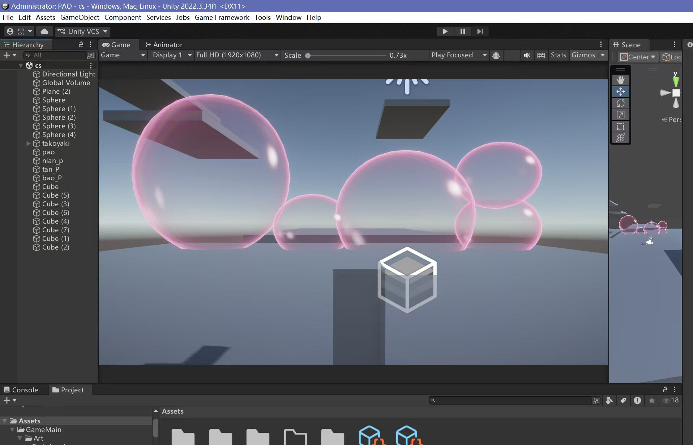

*（Unity 中的初版可破坏泡泡，尚未美术加工）*

### 配色关系

```
              云粉 #F5C6D8（基调）
             ╱              ╲
      雾紫 #B48BC4 ──── 水青 #7ED4D4
             ╲              ╱
              藕荷 #D9A8D0
              （粉紫过渡）
```

**配色逻辑**：

| 组合 | 效果 |
|------|------|
| 粉 + 紫 | **主基调**——梦幻、温柔 |
| 粉 + 青 | **冷暖对比**——制造焦点 |
| 紫 + 青 | 深度层次 |
| 暖橙 / 珊瑚 | **点睛**——暖色打破冷调 |

> **设计要点**：
> 1. 前三关教学主画面**白色为主**，粉/青/橙用于少量功能与危险点缀。
> 2. 旧粉紫大面积氛围与水青海洋方向仅适用于记忆远景或后续空间，不作为当前第 2、3 关主色比例定案。
> 3. 危险反馈醒目但不覆盖教学对象；具体面积比例另行确认。

### 情绪演进（按关卡）

| 阶段 | 主色调 | 情绪 |
|------|--------|------|
| 1 | **白色为主 + 少量粉色** | 空白、初醒 |
| 2 | **白色为主 + 少量浮力/黏合功能色**；粉紫水青记忆远景 | 探索、好奇 |
| 3 | **白色为主 + 少量爆炸危险色**；运动反馈突出 | 组合、风险认知 |
| 4 | **深紫 + 夜紫 + 深海青** | 压抑、坠落 |
| 5 | 回归 **云粉 + 霞粉** | 释然、回归 |

> **色彩也是莫比乌斯**：第 5 关的配色 = 第 1 关的配色。

## 10.2.1 参考图

### 整体基调

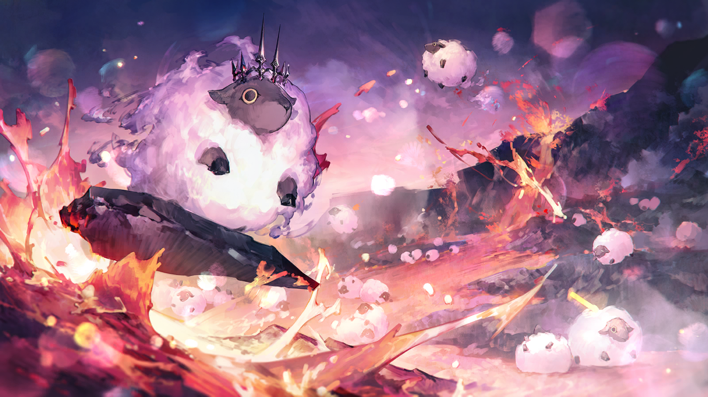

*（《明日方舟》火山旅梦活动 CG）*

**提取要点**：
- 粉紫渐变天空
- 厚涂笔触，色彩交融
- 朦胧光晕，边缘柔和
- 暖色火光打破冷调

### 关卡场景

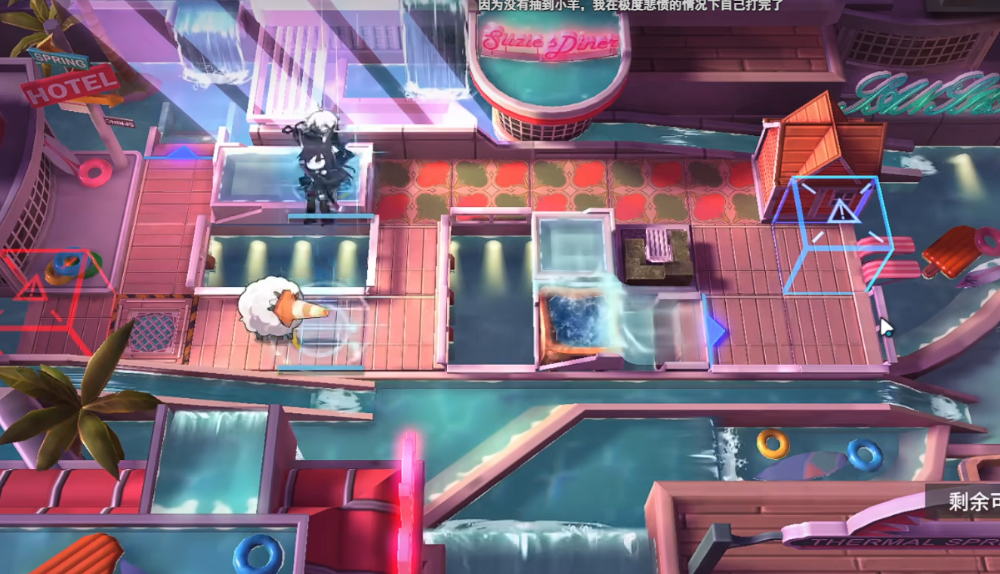

*（活动关卡地图）*

**提取要点**：
- **斜俯视箱庭**结构
- 水面 + 木板平台
- 珊瑚色暖点缀
- 清晰的区块划分

### 地编参考

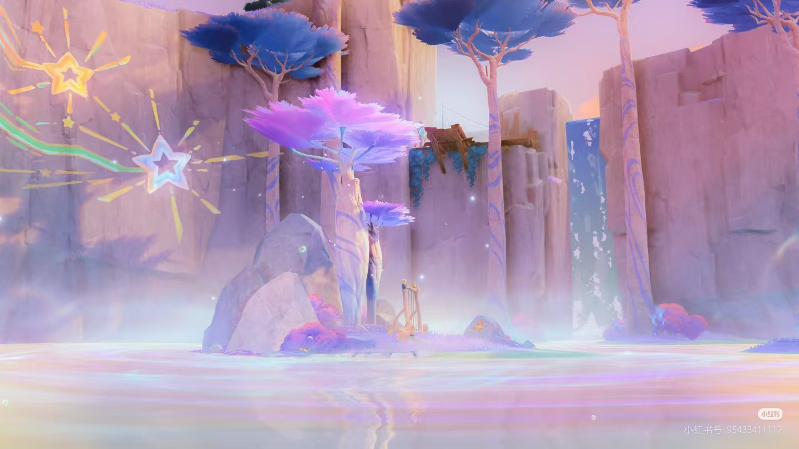

**地编白盒参考**（当前阶段）：

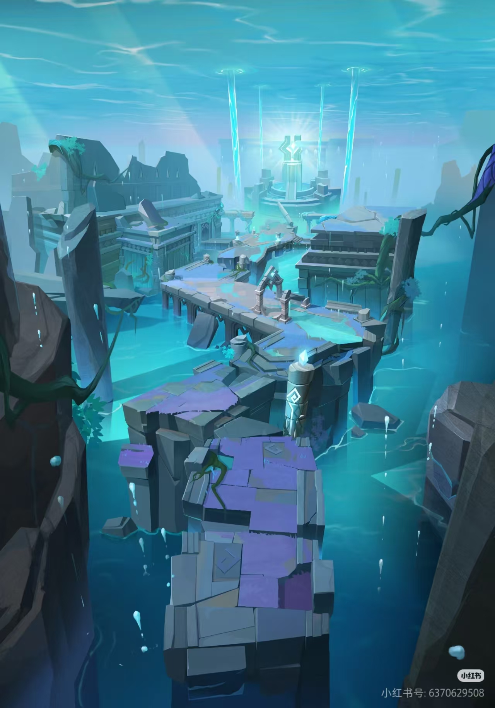

*（水下遗迹结构参考——斜俯视纵深、石板平台、下方水面的空间关系。
颜色为白盒阶段，最终按粉紫基调调整。）*

*（地编同学参考图，不一定要做成这样）*

**提取要点**：
- 粉紫岩壁、梦幻光效
- 星星等装饰元素
- 柔和的体积光

## 10.2.2 地图结构：箱庭

| 项 | 内容 |
|----|------|
| 结构 | **箱庭**（Diorama / 微缩景观） |
| 视角 | **斜俯视**（固定机位，参考图四/图五） |
| 边界 | 每关是独立的封闭空间 |

### 场景演进

| 关卡 | 场景 | 说明 |
|------|------|------|
| **第 1 关** | **白色教学空间** | 诞生泡泡体、粉色泡泡墙，空旷、干净 |
| **第 2、3 关** | **白色教学空间 + 记忆景观可窥见** | 分别突出空洞与黏合群、定向移动泡泡与爆炸陷阱 |
| 后续 / 记忆远景 | 保留海洋水下方向 | 珊瑚、海草、水泡、光线、深海与海底遗迹 |

> **优先级**：教学对象的可读性优先于景观密度；保留海洋记忆方向，不再要求第 2 关起的教学主画面转为粉紫水下。

### 箱庭设计优势

| 优势 | 说明 |
|------|------|
| **边界清晰** | 玩家一眼看到整个空间 |
| **契合设定** | 每个箱庭 = 一个记忆泡泡的内部 |
| **手绘厚涂适配** | 微缩景观适合表现笔触材质 |
| **制作可控** | 每关独立，可并行制作 |

```
┌─────────────────┐
│   ╭─────────╮   │  ← 箱庭边界（泡泡膜）
│   │  水下   │   │
│   │  🪸 ◆   │   │      ◆ 玩家
│   ╰─────────╯   │      🪸 珊瑚
└─────────────────┘
     可整体观看的微缩空间
```

### 海洋元素清单

以下海洋元素保留用于可窥见的记忆景观和后续空间，不要求从第二关开始铺满教学房间：

| 元素 | 用途 |
|------|------|
| **珊瑚** | 装饰、平台、障碍 |
| **海草** | 动态装饰、可穿过 |
| **水泡** | 上升气流、视觉引导 |
| **光线** | 水下体积光、氛围 |
| **岩石** | 地形、掩体 |
| **贝壳 / 海星** | 点缀、可交互物 |

## 10.3 泡泡空间表现

> **既有资产名称对照**：本节图稿中的“浮粘”“炸弹”分别对应浮力/黏合能力与爆炸泡泡；图稿及图片路径保留。两种漂浮状态只是旧候选表现，不锁定本版飞行控制、阈值或时长。

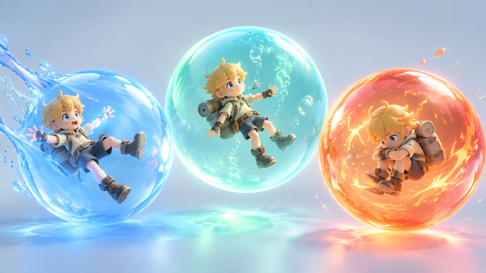

*（设计稿：同一角色在三种泡泡空间中的表现）*

| 元素 | 表现 |
|------|------|
| 主体 | 半透明球体 |
| 边缘 | 明亮菲涅尔光晕 |
| 内部 | 可见，有水面般光泽与细碎水珠折射 |
| 底部 | 地面上有对应颜色的投影 |

### 三种泡泡的视觉区分

| 泡泡 | 颜色 | 内部特征 | 角色姿态 |
|------|------|---------|---------|
| **弹力** | 蓝 | 表面有弹性拉伸形变 | 被弹射出去 |
| **浮粘** | 青绿 | 内壁有上升的气泡，失重感 | 轻盈漂浮 |
| **炸弹** | 橙红 | 能量涌动、碎块翻腾 | 抱膝防御 |

**区分原则**：三种泡泡**靠颜色 + 内部动态**区分，不靠形状（形状统一为球体）。
玩家一眼就能判断这是哪种泡泡，而不需要看图标。

### 主角形象

> ⚠️ **v2.26 重设**：半透明蓝色**果冻水母** + 大号**头戴式耳机**；取代 v2.15 的“蓝色水母 + 储泡泡液罐”方案。

#### 两种呈现形式

| 形式 | 用途 | 说明 |
|------|------|------|
| **游戏内** | 实际游玩 | 蓝色果冻水母，圆润 Q 版比例 |
| **人形立绘** | 剧情演出、菜单、宣传 | 是否保留待确认；若保留，需延续耳机、星星与果冻质感要素 |

> **为什么游戏内用 Q 版水母**：操作清晰、比例可爱、果冻/泡泡材质与世界统一；立绘是否继续承担叙事与宣传，待团队确认。

#### 游戏内形象（v2.26 正 / 背面）

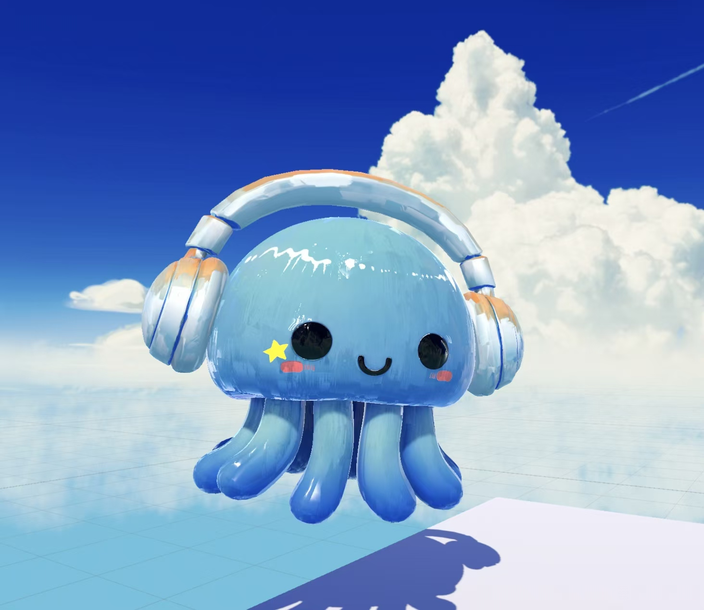
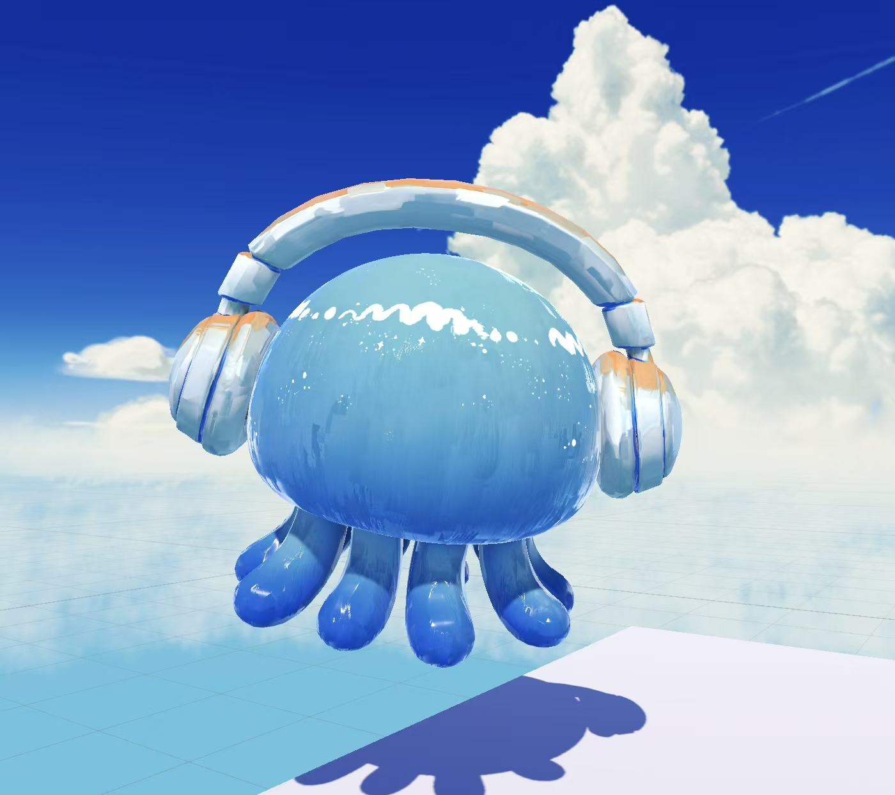

**游戏内 3D 形象**（模型师当前稿）：

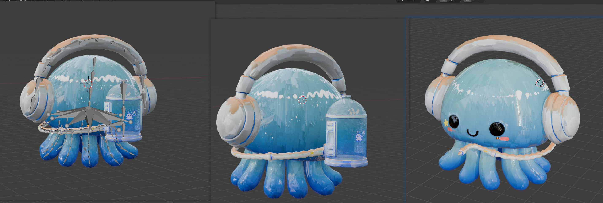

*（左：背面 / 中：侧面 / 右：正面）*

| 项 | 内容 |
|----|------|
| 造型 | **半透明蓝色果冻水母**——圆顶状头部、**6 条**圆润触手，光线可穿透，内部由浅到深蓝渐变 |
| 质感 | 果冻/软糖般饱满通透；头部表面有液体波纹状白色高光，触碰与运动时允许轻微形变 |
| 配饰 | **大号头戴式耳机**——透明果冻材质（浅蓝白），头梁顶部与耳罩外侧有**橙色涂装**；为当前唯一配饰 |
| 面部 | 两个大圆黑豆眼（带高光）、黑色弯月微笑 |
| 贴纸 / 腮红 | 左眼下方**黄色五角星贴纸**；两颊粉色涂抹状腮红 |
| 比例 | 头大身小的 Q 版比例 |
| 配色 | 以水青/蓝为主色，橙色仅出现在耳机，黄色星星与粉色腮红为小面积点缀 |

#### 人形立绘设定（待确认）

旧稿设想水母人形化、保留同一角色身份。v2.26 后若继续使用，保留元素需更新为：水母伞盖 → 发型/头饰；**耳机 → 随身配饰**；星星贴纸与腮红保留。是否制作、气质与用途由团队确认。

#### 通用

| 项 | 内容 |
|----|------|
| 定位 | 原创设计，**不模仿任何已有游戏角色** |

#### 旧稿配饰对照：储泡泡液罐（已移除）

旧稿的“糖果色储泡泡液罐 + 橙色布质绑带 + 螺旋软管”在 v2.26 被头戴式耳机取代。储罐原本承担“泡泡液来源”的物质依据；移除后泡泡液由水母本体承载还是另有设定，见 §15 **D10**，不由外观调整直接推导。

### 美术风格：手绘厚涂

> 详见 [10.1 风格](#101-风格) 与 [10.2 色彩](#102-色彩)。

| 项 | 内容 |
|----|------|
| 笔触 | 可见的手绘笔触，颜料堆积感 |
| 配色 | 粉紫基调 + 水青 |
| 气质 | 温暖治愈、梦幻朦胧 |

> ⚠️ **角色本体保留原有设计**（含粗描边），**仅场景背景采用厚涂风格**。
> 这是当前阶段的折中方案——角色设计已经成熟，不重画。

### 吐泡泡的表情差分

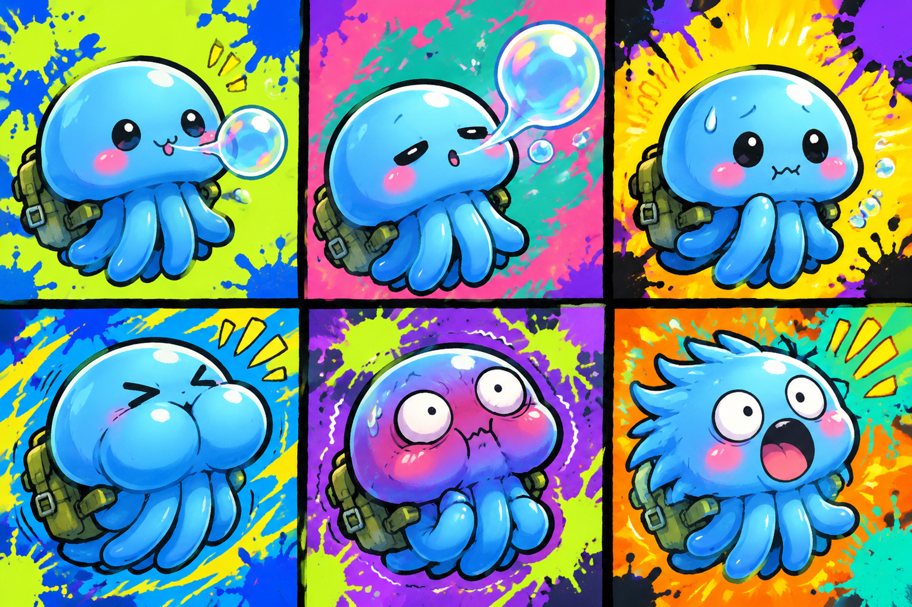

**蓄力与不蓄力，表情完全不同**——这是给玩家的**即时反馈**。

| 泡泡 | 不蓄力 | 蓄力 |
|------|--------|------|
| **弹力** | 轻松嘟嘴吹小泡泡，开心 | 腮帮鼓到极限，眼睛紧闭，身体后仰 |
| **浮粘** | 温柔吐气，眼神迷离放松 | 憋到脸变紫红，眼睛瞪大凸出，搞怪 |
| **炸弹** | 小心翼翼，抿嘴紧张，冒汗 | 夸张惊恐又兴奋，张嘴瞪眼 |

**设计意图**：

| 作用 | 说明 |
|------|------|
| **即时反馈** | 玩家一看表情就知道"蓄了多少" |
| **角色塑造** | 搞怪表情让角色有性格，不只是工具 |
| **降低认知负担** | 不用看 UI，看角色脸就知道状态 |

> 💡 **表情本身就是 UI**——符合“反馈优先于文字”原则。
> 玩家不需要读条，**看角色表情就知道蓄力进度**。

### 角色三视图（8 张状态差分）

> 每张含**正 / 侧 / 背**三个视图，供 3D 建模参考。

#### 弹力泡泡

| 不蓄力 | 蓄力 |
|--------|------|
| 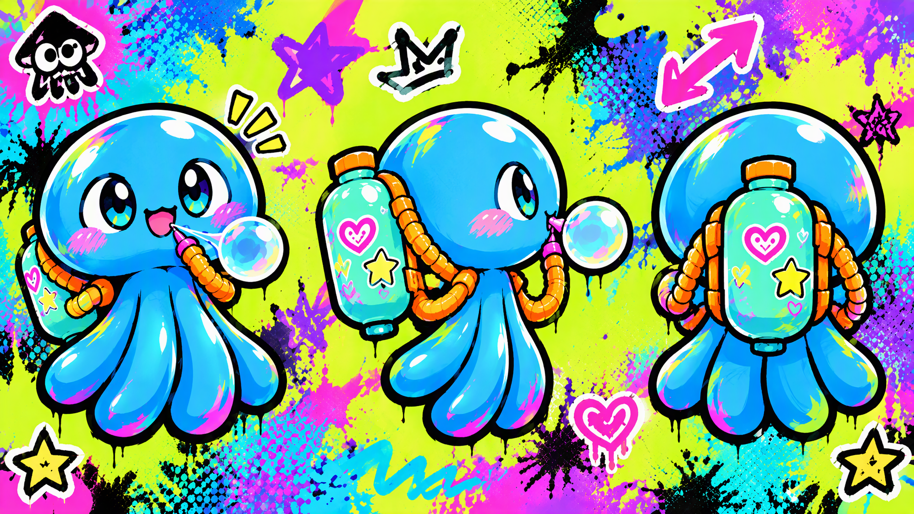 | 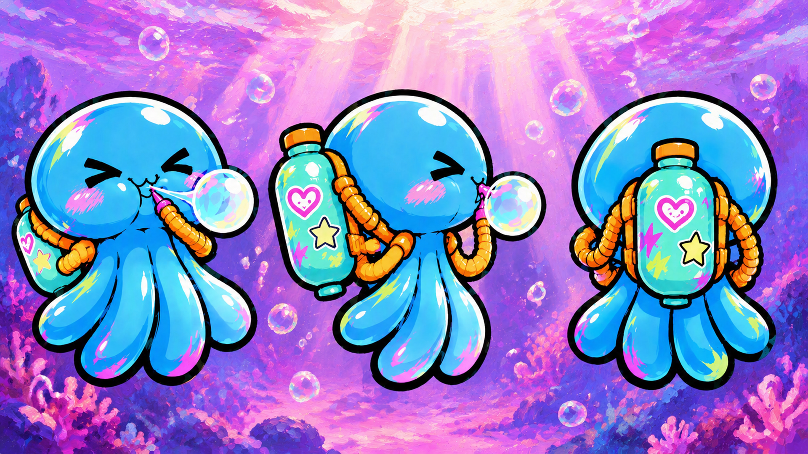 |
| 放松站姿，嘟嘴准备吐泡泡 | 腮帮鼓到极限，眼睛紧闭，身体后仰 |

#### 浮粘泡泡

| 不蓄力 | 蓄力 |
|--------|------|
| 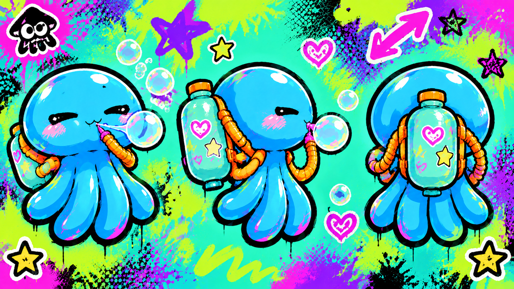 | 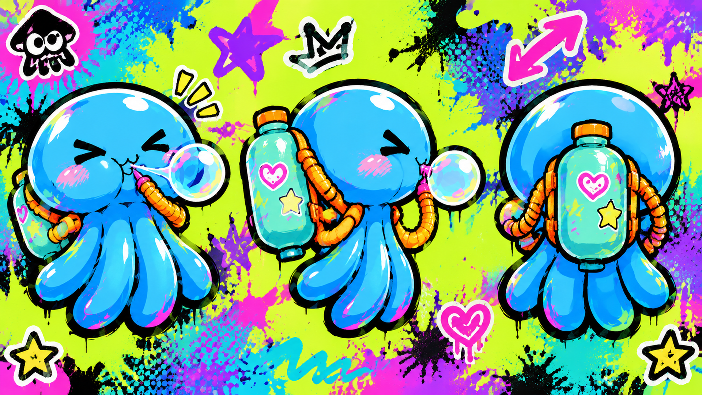 |
| 放松漂浮，温柔迷离 | 憋到紫红，眼睛瞪大凸出 |

**两种漂浮状态**（各自独立出图）：

| 蓄力漂浮 | 泡泡空间漂浮 |
|---------|-------------|
| 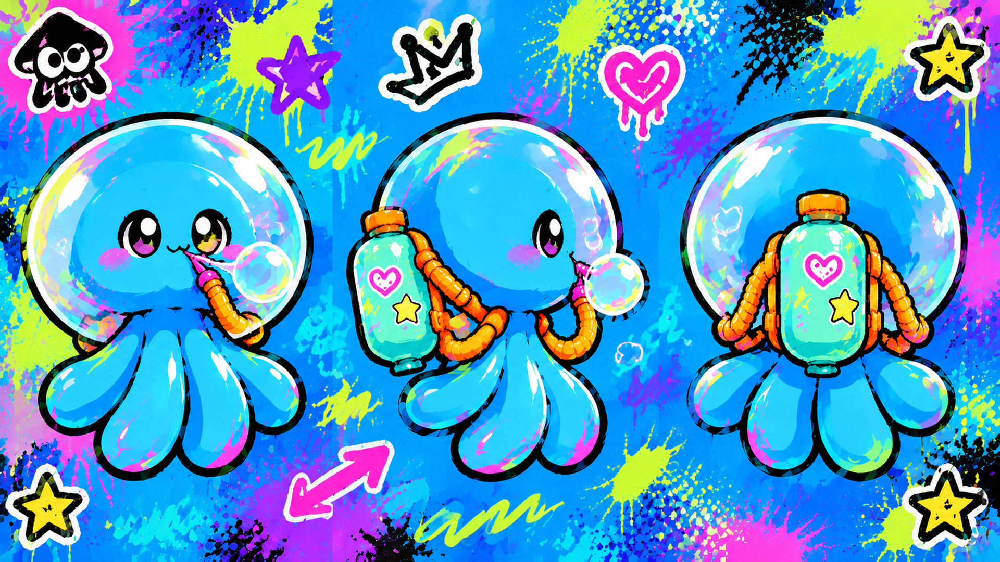 | 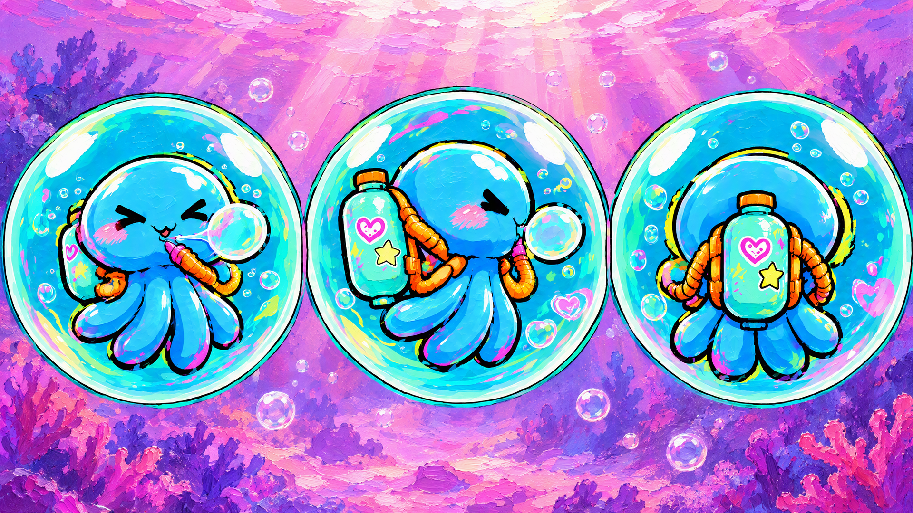 |
| 被泡泡包裹悬空，可控方向 | 置身泡泡空间内，向上飘升 |

#### 炸弹泡泡

| 不蓄力 | 蓄力 |
|--------|------|
| 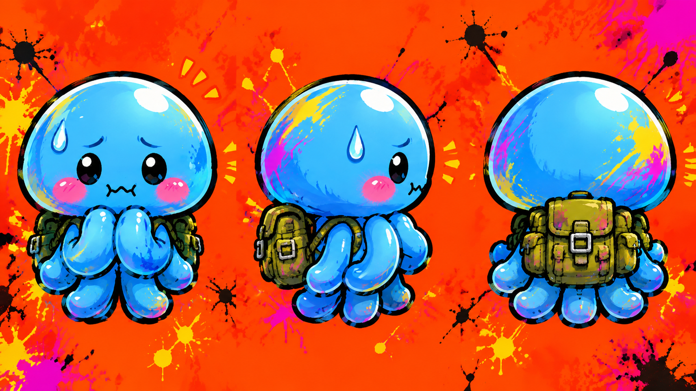 | 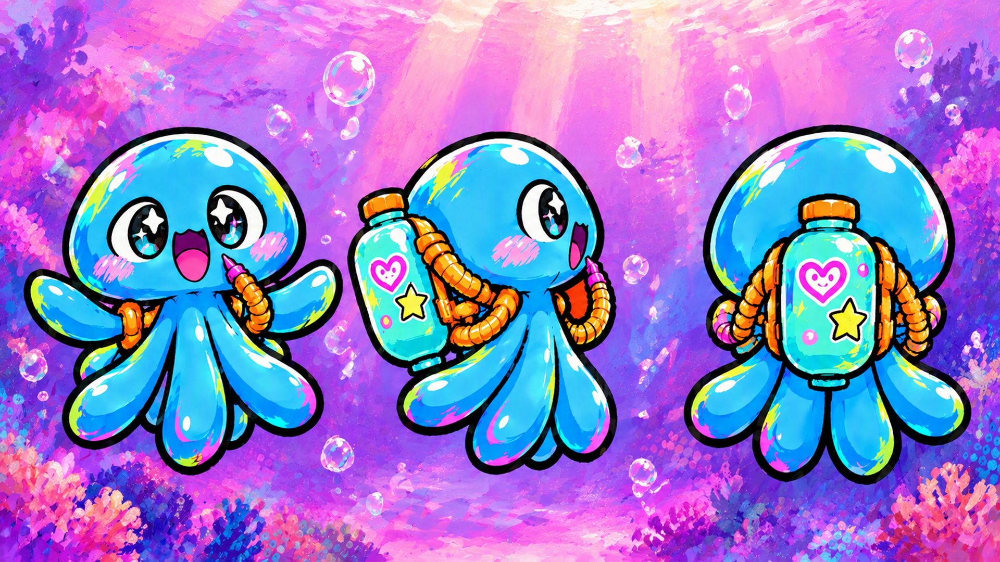 |
| 抿嘴紧张，额头冒汗 | 炸毛、张嘴瞪眼，爆炸感 |

### Spine 部件拆分（旧稿参考）

> 下图与 13 部件基于旧形象（5 触手 + 储罐）；新形象的部件构成以 §10.3 的 6 触手 + 耳机表为准。

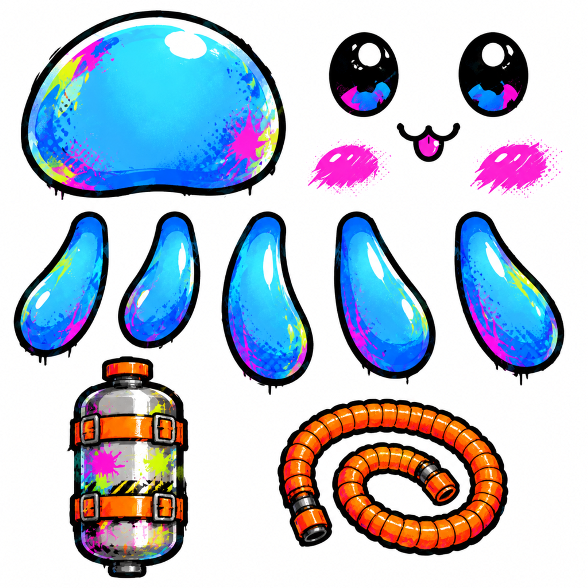

**拆分为 13 个独立部件**，用于 Spine 骨骼绑定：

| 部件 | 数量 |
|------|------|
| 头部 | 1 |
| 眼睛 | 2 |
| 嘴巴 | 1 |
| 腮红 | 2 |
| 触手 | 5 |
| 储泡泡液罐 | 1 |
| 软管 | 1 |

**动画用途**：

| 动画 | 用到的部件 |
|------|-----------|
| 待机（呼吸） | 头部 + 触手轻微摆动 |
| 蓄力（鼓腮） | 头部形变 + 眼睛变化 |
| 吐泡泡 | 嘴巴 + 头部前倾 |
| 漂浮 | 全部触手摆动 |

> **拆分原则**：面部五官独立，便于**用一张头 + 不同五官组合出所有表情**，
> 而不需要为每个表情单独画一张完整图——大幅降低美术量。

## 10.4 动画需求

> ⚠️ **动画是本作的大项**——详见 [06-美术需求.md](06-美术需求.md) 第七章。

**核心动画清单**：

| 类别 | 关键动画 |
|------|---------|
| **泡泡墙** | ⭐ **破裂**（分裂→飞散）、**愈合**（膨胀→融合） |
| **角色** | 待机、移动、跳跃、**蓄力果冻形变**（分阶段）、吐泡泡、漂浮 |
| **泡泡** | 发射、飞行、弹射、包裹漂浮、黏合、引爆、**破坏补充回升**；自动消散为待确认候选 |
| **泡泡潮** | 旧扩展候选：扩散、增殖、被破坏、逼近 |
| **环境** | 水下光线、海草摆动、水泡上升、记忆残影 |
| **UI** | 泡泡值指示、破坏补充回升、爆炸消耗下降、蓄力指示、机制命名与记忆文字 |
| **叙事** | 关卡开场、记忆触发、**结局消散** |

> 💡 **泡泡墙的「破裂 → 愈合」动画本身就是教学**——
> 玩家看完就理解了三条规则，不需要任何文字说明。

## 10.5 记忆反馈表现

**克制原则**：不弹窗、不打断、不用大段文字。

| 反馈类型 | 表现 |
|---------|------|
| 残影 | 浮现半透明人影，数秒后消失 |
| 声音 | 环境音变化，或一句极轻的旁白 |
| 画面 | 色调微变、光晕 |
| 文字 | **最多一句**，出现在画面边缘 |

---

# 十一、音频设计

## 11.1 核心音效

| 事件 | 音效 |
|------|------|
| 蓄力 | 逐渐升高的嗡鸣 |
| 释放 | "啵"的一声 |
| 弹力泡泡 | 弹性回响 |
| 浮粘泡泡 | 轻柔的气泡声 |
| 炸弹爆炸 | 低沉爆破 + 水花 |
| 破坏补充 | 破坏泡泡时泡泡值回升的清脆反馈，与爆炸消耗区分 |
| 爆炸消耗 | 爆炸时泡泡值下降的反馈，无回升提示 |
| 掉入空洞并返回 | 声音收束后衔接房间初始点，不表达永久死亡 |

## 11.2 音乐设计

| 章节 | 音乐 |
|------|------|
| 序 | 钢琴单音，稀疏、温柔 |
| 破 | 加入低频弦乐，逐渐不和谐 |
| 急 | 弦乐紧张，节奏加快 |
| 结局 | 回到开头的钢琴单音，然后归于静默 |

---

# 十二、UI / UX

## 12.1 设计原则

**一切皆泡泡。** UI 元素也用泡泡形态呈现。

## 12.2 HUD

**极简**。除泡泡值指示外，HUD 按教学与交互需要临时出现。

| 元素 | 何时出现 |
|------|----------|
| **泡泡值指示** | 常驻，显示当前可用资源 |
| 蓄力指示 | 蓄力时显示泡泡大小与预计资源消耗 |
| 破坏补充提示 | 资源教学或破坏泡泡时出现，显示泡泡值回升 |
| 爆炸消耗提示 | 爆炸后显示泡泡值下降，提示去破坏补充 |
| 泡泡切换 | 切换时短暂显示 |
| 爆炸泡泡状态 | 爆炸泡泡存在时提示可控状态；引爆方式及数量上限待确认 |
| 机制命名 / 记忆文字 | 操作反馈后或记忆触发时，简短出现 |

**泡泡值指示是唯一常驻 HUD**；其余元素保持低干扰，不能用固定“单枚”或固定引爆键暗示待定参数已定。

## 12.3 教学

**反馈优先于文字**——先操作、先看见因果，再用简短提示命名“破坏补充”“连接体”等机制，最后解锁自由；不要求绝对零文字，也不以提示代替实际教学。

---

# 十三、技术架构

## 13.1 ⚠️ 待确认：开发平台

| | UrhoX（TapTap Maker） | Unity |
|---|---|---|
| 语言 | Lua 5.4 | C# |
| 现状 | `/workspace` 已有框架 | 无 |

**本文档与平台无关**——规则、关卡设计两边通用。

## 13.2 核心系统模块

```
1. 泡泡实体系统      —— 泡泡的状态、材质、位置
2. 泡泡空间系统      —— 空间创建、进入判定、效果
3. 三种泡泡能力      —— 弹力 / 浮力与黏合 / 爆炸
4. 蓄力输入系统      —— 长按蓄力 → 大小 → 强度
5. 瞄准引导线        —— 抛物线预测、落点标记
6. 世界规则引擎      —— 分裂 / 融合 / 膨胀
7. 3D 角色控制       —— 移动、跳跃、相机
8. 关卡/房间管理     —— 房间切换、诞生泡泡体存档、空洞返回与重置
9. 泡泡值资源        —— 消耗、破坏补充、爆炸消耗
10. 教学阶段管理     —— 限制行动、反馈、命名、解锁与逐关验收
```

## 13.3 技术要点

| 项 | 说明 |
|----|------|
| 3D 物理 | 泡泡空间需要碰撞体 |
| 弹射计算 | 三维弹球需要精确的反射向量 |
| 引导线 | 抛物线预测需要物理模拟或解析解 |
| 泡泡渲染 | 半透明球体，注意 overdraw |

---

# 十四、开发计划

## 14.1 里程碑

| 阶段 | 目标 | 出口标准 |
|------|------|---------|
| **P0 概念验证** | 证明泡泡手感好玩 | 蓄力释放 + 泡泡空间可玩 |
| **P1 垂直切片** | 证明一关成立 | 第 1 关完整可玩 |
| **P2 内容生产** | **第一版 5 关完成** | 5 关可玩（展示范围） |
| **P3 打磨** | 手感、美术、音频 | 可提交第一版 |
| **P4 扩展**（后续） | **尽可能多关卡** | 在 5 关基础上持续扩展 |

## 14.2 P0 关键验证（最高优先级）

**要验证的问题**：

1. **蓄力手感**——大小与力度反馈是否清楚；T03 力度曲线与资源消耗曲线分别测试。
2. **资源闭环**——破坏补充回升、爆炸消耗下降是否可辨认；T04、T06、T07 不直接沿用旧数值。
3. **连接与浮力**——玩家能否自制连接体，并利用包裹飞行跨越空洞；阈值、控制和黏合限制待确认。
4. **物理组合**——大质量惯性与大小相关向外力是否形成可读的移动/解谜效果。
5. **教学与失败**——首次破坏后才解锁移动，破坏补充教学有可用目标，空洞返回房间初始点；P1 按 §8.4 完成整关验收。

**不含**：美术、多关卡、存档、完整剧情。

---

# 十五、待确认项

## 15.1 核心待定参数（9 项）

**状态全部为 TBD**。本表保留用户的参数范围，不擅自填入数值；旧稿基准见 §6.8，不与本表并列为“已确认”。

| 编号 | 项目 | 待定内容 | 关联教学 |
|------|------|----------|----------|
| T01 | **粉色泡泡恢复时间** | 从破坏到恢复的时间、愈合开始与速度。 | 第 1 关、场景恢复 |
| T02 | **第一关资源教学触发阈值** | 破坏多少个泡泡后提示泡泡值有限并引导破坏补充。 | 第 1 关 |
| T03 | **蓄力时间与力度曲线** | 蓄力时长、泡泡大小、力度与破坏效率之间的关系；不同效果参数分别确认。 | 第 1 关及后续能力 |
| T04 | **泡泡值上限与破坏回复效率** | 可用量上限、破坏泡泡的回复量。 | 全关卡 |
| T05 | **浮力泡泡包裹玩家的大小阈值** | 以何种尺寸/体积指标判定包裹，阈值是多少。 | 第 2 关 |
| T06 | **爆炸泡泡消耗量** | 爆炸消耗的泡泡值及其与泡泡大小的关系。 | 第 3 关 |
| T07 | **破坏回复速率与平衡** | 破坏泡泡回复泡泡值的量、与爆炸消耗的平衡。 | 第 1、3 关 |
| T08 | **爆炸力—大小公式** | 爆炸力 = f(泡泡大小)；曲线、范围及受力衰减待定，不默认线性。 | 第 3 关 |
| T09 | **空洞返回点与重置范围** | 已确定返回房间初始点；精确位置，以及泡泡、连接体、资源、墙体、教学进度的保留/重置范围待定。 | 失败返回 |

## 15.2 补充设计决策

这些是让上述规则可实现、可验收所需的细化项，**不是本次新增定案**。D10 为 v2.26 新增。

| 编号 | 待确认内容 | 保留边界 |
|------|------------|----------|
| D01 | 破坏补充与资源不足提示的呈现；黏合态连接体拆解；自动消散、取消蓄力及未引爆泡泡的结算。 | 泡泡值靠破坏补充、爆炸消耗不产生补给的通用规则不变。 |
| D02 | 飞行控制方式、持续时长、退出方式；黏合触发条件、可逆性、落点与失去浮力的关系。 | 2 倍、5 秒、只能向上、接触即黏合均保留为旧候选，不作为本次已确认控制方式。 |
| D03 | 爆炸具体触发方式、并发数量、是否伤害玩家。 | 主动、碰撞、组合均为候选；远程按键、一次一枚为旧方案。 |
| D04 | 弹力前置材料如何构建/生成/转化为粉色泡泡；连接体拼接、拆解与稳定条件。 | 工具即材料与玩家自制通关工具的方向已确定，不编新转化流程。 |
| D05 | 场景破坏回复是否启用及有限容量；爆炸永久破坏的适用材质、范围与关键通路保护。 | 保留旧扩展，不与粉色恢复及破坏补充教学混淆。 |
| D06 | 增值泡泡潮是否加入第三关、启动点、扩散速度与密度、追上后的返回/重置。 | 不作为本次核心验收，不抢在爆炸教学之前施加压力。 |
| D07 | 第四、五关的房间布局、组合解法、考核与叙事节点。 | 保留“组合”“共鸣”方向，不在本次补定。 |
| D08 | 正式开发平台：Unity 还是 UrhoX。 | 当前已有 Lua 框架与 Unity 灰盒参考，需团队确认。 |
| D09 | 玩家可用量与各泡泡体容量的关系；资源消耗曲线、补给与返回结算。 | 旧上限 100、消耗 1/10 与线性资源消耗仅为测试候选，不能推导力度曲线已定。 |
| D10 | 储罐移除后泡泡值的承载方式（水母本体/耳机/其他）；人形立绘是否保留；耳机是否与“听见记忆”等叙事主题呼应。 | 主角外观以 v2.26 果冻水母 + 耳机为准；不擅自把耳机写成功能性装备。 |

## 15.3 已确定的规则

| 项 | 决定 | 出处 |
|----|------|------|
| 术语与教学节奏 | 泡泡体、泡泡值、破坏补充、爆炸消耗等统一命名；限制 → 操作 → 反馈 → 命名 → 自由。 | §0、§8.3 |
| 资源来源 | 泡泡值靠破坏可破坏的泡泡恢复；爆炸消耗不产生补给。 | §6.2 |
| 初始存档与空洞失败 | 诞生泡泡体是最初存档点；掉入空洞返回房间初始点。 | §0.2、§6.6 |
| 第一关 | 首次破坏后解锁移动；有限资源与破坏补充；蓄力；弹力是粉色泡泡前置材料。 | §8.4 |
| 第二关 | 泡泡连接体是玩家自制工具；浮力达到阈值可包裹飞行跨越空洞。 | §8.5 |
| 第三关 | 已具飞行能力；组合物理、大质量惯性、玩家可控爆炸、大小相关向外力。 | §8.6 |
| 视觉 | 前三关白色主色、少量交互类型，可窥见记忆世界；主角为半透明蓝色果冻水母 + 头戴式耳机（v2.26）。 | §0.2、§10 |
| 版本范围 | 1–3 教学，4–5 综合运用；完整叙事为后续目标。 | 版本范围、§8 |

**确认方式**：TBD 需经原型测试与团队确认后再写入定案，关联速览、开发和美术文档同步；不把“程序暂定”当作参数已批准。
