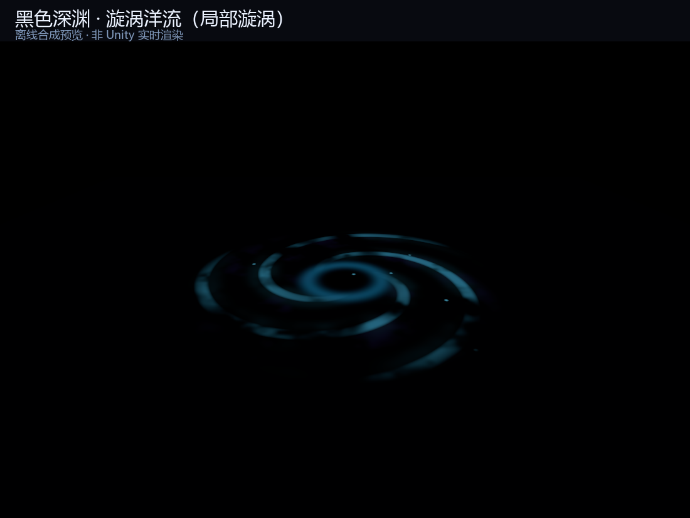

# 岩浆 / 黑色深渊 —— 材质与深渊死亡区

卡通平台跳跃用的两套环境材质，外加一个可以直接拖进场景的「掉下去就回出生点」深渊。

> 上图是按 shader 同一套公式离线渲染的配色预览，不是 Unity 实时截图；实际还会叠加两层体积雾、浮尘粒子和一盏冷光。

## 文件

| 内容 | 路径 |
| --- | --- |
| 岩浆 shader | `Assets/GameMain/Art/Shaders/PAO_Lava.shader` |
| 岩浆参数 | `Assets/GameMain/Art/Shaders/PAO_LavaCore.hlsl` |
| 深渊 shader | `Assets/GameMain/Art/Shaders/PAO_Abyss.shader` |
| 深渊参数 | `Assets/GameMain/Art/Shaders/PAO_AbyssCore.hlsl` |
| 深渊雾 shader | `Assets/GameMain/Art/Shaders/PAO_AbyssFog.shader` |
| 深渊浮尘 shader | `Assets/GameMain/Art/Shaders/PAO_AbyssMote.shader` |
| 公共噪声 | `Assets/GameMain/Art/Shaders/PAO_EnvironmentNoise.hlsl` |
| 岩浆材质 | `Assets/GameMain/Art/Materials/LavaAbyss/M_Lava.mat` |
| 深渊材质 | `Assets/GameMain/Art/Materials/LavaAbyss/M_Abyss.mat` |
| 深渊雾材质 A / B | `Assets/GameMain/Art/Materials/LavaAbyss/M_AbyssFog_A.mat` / `M_AbyssFog_B.mat` |
| 浮尘材质 | `Assets/GameMain/Art/Materials/LavaAbyss/M_AbyssMote.mat` |
| 浮尘脚本 | `Assets/GameMain/Scripts/Gameplay/AbyssMotes.cs` |
| 岩浆预制体 | `Assets/GameMain/Prefabs/Environment/PF_Lava.prefab` |
| 深渊预制体 | `Assets/GameMain/Prefabs/Environment/PF_Abyss.prefab` |

## 岩浆

直接把 `M_Lava` 拖到平面上，或者把 `PF_Lava` 拖进场景（100 × 100 米，带材质、没有碰撞）。

| 参数 | 作用 |
| --- | --- |
| `_Scale` | 结壳块大小，越小块越大 |
| `_CrustAmount` | 结壳面积 |
| `_CrackWidth` / `_CrackGlow` | 裂纹宽度 / 亮度 |
| `_Emission` | 整体发光强度（没有 Bloom 时 1.2 左右） |

## 黑色深渊（漩涡版）

### 这一版是什么

上一版是一块「有雾的黑地板」，远看没有形状。这一版把深渊做成：

- **一块无限黑的底板**：黑色从中心向外收，离漩涡越远越纯黑
- **一个约 70 米宽的漩涡**：中心是黑洞，外面是两层不同速度的螺旋洋流
- **断续的冷色泡沫**：只在洋流边缘露出来，不是连续的霓虹线
- **两层体积雾**：一青一紫，漂在漩涡上方，相机移动时有真实视差
- **一层浮尘粒子**：220 颗冷色微粒在深渊里缓慢上升
- **一盏冷光**：给附近的平台底部一点幽蓝的反射光

### 预制体结构

`PF_Abyss` 是 200 × 200 米的平面，内部是：

| 子物体 | 作用 |
| --- | --- |
| `Void` | 漩涡底板，`M_Abyss` |
| `Fog_A` | 低层雾，`M_AbyssFog_A`，2 米高 |
| `Fog_B` | 高层雾，`M_AbyssFog_B`，6 米高 |
| `Motes` | `AbyssMotes`，运行时生成浮尘粒子 |
| `Glow` | 冷色 Point Light |
| 根物体 | `FallRespawn`（按本物体高度） |

### 用法

1. 把 `PF_Abyss` 拖到关卡最低处，让 **漩涡中心** 对准玩家最容易掉下去的区域。
2. 平面下面不要再放别的能接住玩家的地板。
3. 运行。玩家掉到「深渊平面 + 0.35 米」以下，就会回到开局位置。

### 调参

| 参数 | 作用 |
| --- | --- |
| `_VortexRadius` | 漩涡占平面的比例，默认 `0.35`。想让它更小、周围留更多纯黑，就调到 `0.2`；想让它铺满，就调到 `0.8` |
| `_Arms` | 螺旋臂数量，默认 3 |
| `_Twist` | 螺旋卷曲程度，默认 7 |
| `_SpinSpeed` | 旋转速度，负值反向 |
| `_MistStrength` | 洋流亮度 |
| `_FoamStrength` | 泡沫亮度 |
| `_RingStrength` | 中心那圈冷光 |
| `_MoteStrength` | 底板自带的少量浮尘 |
| `_OuterFade` | 外圈收黑的范围 |

雾的浓度在 `M_AbyssFog_A/B` 的 `_Opacity` 里；浮尘的数量/范围在 `Motes` 物体的 `AbyssMotes` 组件上。

> 浮尘是运行时生成的，**编辑模式看不到，Play 之后才会出现**；雾和漩涡在编辑模式就能看到。

### 深渊死亡逻辑

- 判定高度 = 深渊平面的 Y + **0.35 米**
- 连续低于判定高度 **0.2 秒** 后重生（给一点坠落感）
- 重生点 = 玩家开局位置（原初始点）；也可以在 `Fall Respawn` 上指定 `Spawn Point`
- 场景里如果已经有别的 `FallRespawn`，不要再放第二个

## 性能

- 底板 Opaque，带 `DepthOnly` / `DepthNormals`，兼容工程里的 SSAO
- 两层半透明雾，雾 shader 只有 2 层噪声，开销不大
- 220 颗粒子 + 1 盏无阴影点光
- 不依赖 Bloom；有 Bloom 时泡沫和浮尘会自然晕开

## 已知取舍

- 漩涡是 UV 居中的，所以整块深渊要移动/缩放到漩涡对准落点；`_VortexRadius` 可以控制它占多大
- 雾是两层平面，不是真正的体积雾；如果平台柱子穿过雾层，交界处可能看到一条直边。把雾层放低/放高，或者避开柱子即可
- 深渊仍然是一块死亡平面，不是无限下落的物理空间；玩家会在 0.2 秒后传送回去
